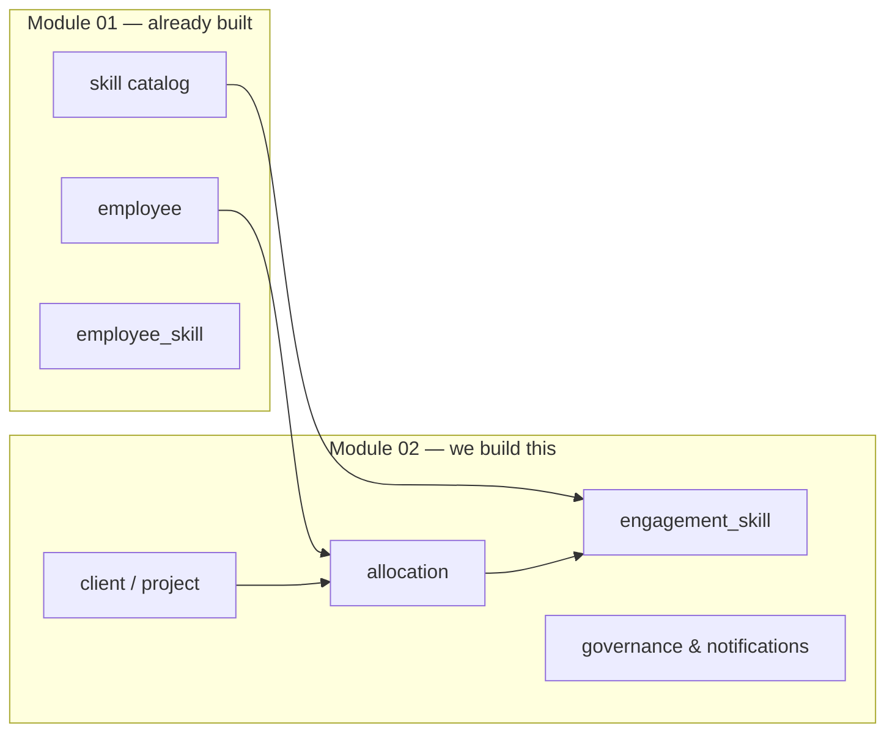
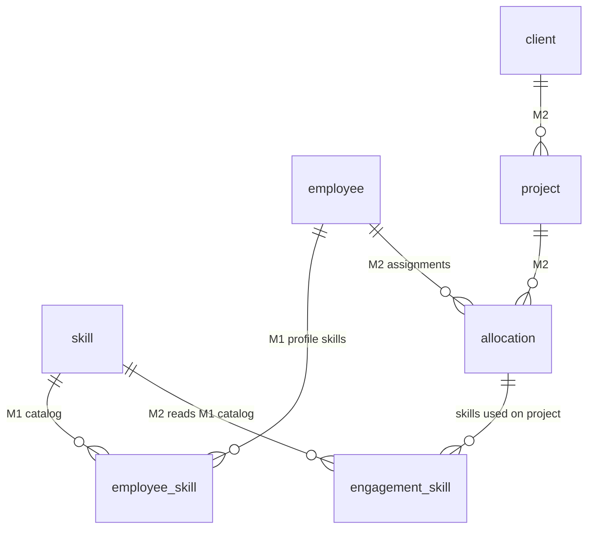

# Module 02 — Data Model Guide (How to Read the ERD)

**Purpose:** Explain what already exists (Module 01), what we are adding (Module 02), and how to interpret the diagrams in [`m2-erd.md`](./m2-erd.md).

**Related docs**
- Diagrams: [`m2-erd.md`](./m2-erd.md)
- M2 column details: [`m2-data-model.md`](./m2-data-model.md)
- M1 column details: [`docs/db/data-model.md`](../../db/data-model.md)

---

## 1. The big picture in one sentence

**Module 01** stores *who people are* and *what skills they have*.  
**Module 02** stores *who works on which project*, *when*, and *at what capacity* — built on top of the same `employee` and `skill` records.

We are **not** replacing Module 01. We extend two existing tables and add **16 new ones** in the same PostgreSQL database (**34 tables total** in MVP).



---

## 2. How to read the ERD diagrams

The ERD file has **7 sections**. Use them in this order when preparing to explain the model.

| ERD section | What it shows | When to use it |
|-------------|---------------|----------------|
| **What changes (short)** | Summary tables — fastest overview | Opening a review call |
| **§1 High-level** | M1 vs M2 boxes and arrows | “What sits on top of what?” |
| **§2 Module 01 full ERD** | All existing tables and relationships | “What do we already have?” |
| **§3 Module 02 full ERD** | All new tables and relationships | “What are we building?” |
| **§4 Combined view** | Only the tables that **bridge** M1 and M2 | Best single diagram for stakeholders |
| **§5 Complete ERD** | **All 34 in-scope tables (M1 + M2)** | **Full database in one diagram** |
| **§6 Table inventory** | Counts, migrations, deferred tables | Implementation planning |
| **§7–8 Chains & flows** | How data moves through the system | Explaining user journeys |

### Diagram notation

| Symbol / label | Meaning |
|----------------|---------|
| `PK` | Primary key — unique row identifier (UUID) |
| `FK` | Foreign key — points to a row in another table |
| `UK` | Unique constraint — no duplicates allowed |
| `||--o{` | One-to-many (one parent, many children) |
| `||--o\|` | One-to-one (optional) |
| Dashed arrow `-..->` | Cross-module read (M2 uses M1 data, no duplicate table) |
| `"NEW"` on a column | Added to an existing M1 table by M2 |
| Append-only | Rows are inserted only — never updated or deleted |

### Relationship labels to know

| You see… | It means… |
|----------|-----------|
| `employee \|\|--o{ allocation` | One employee can have many allocations |
| `client \|\|--o{ project` | One client can have many projects |
| `allocation \|\|--o{ allocation_history` | Every allocation change creates history rows |
| `skill \|\|--o{ engagement_skill : "M1 FK"` | Engagement skills must pick from the M1 skill catalog |

---

## 3. Module 01 — what we already have (the foundation)

Module 01 is the **Skill Matrix**. It answers: *Who works here? What skills do they claim? Has a manager validated those skills?*

### 3.1 Domain groups (17 tables, unchanged by M2)

| Domain | Tables | What they store |
|--------|--------|-----------------|
| **Auth & roles** | `user`, `ability`, `role_ability` | Login accounts and roles (Admin, Employee, Line Manager, HR). `ability`/`role_ability` are reserved for future RBAC — MVP reads `user.role` directly. |
| **People** | `employee` | Employee master record: name, email, org unit, manager (`manager_id` self-reference), employment status. |
| **Skill catalog** | `skill_category`, `skill`, `skill_tag`, `skill_tag_mapping`, `knowledge_level` | The canonical list of skills (Java, React, …), grouped by category, with 5 proficiency levels (Beginner → Master). |
| **Employee skills** | `employee_skill`, `employee_skill_history` | What skills each employee has, self-assessed and manager-validated levels, plus immutable change history. |
| **Validation workflow** | `validation_request`, `validation_request_item` | Employee submits skills for manager review; manager approves or rejects per skill. |
| **Certifications** | `certification`, `certification_skill`, `employee_certification` | Cert catalog and which skills each cert covers. |
| **Import & audit** | `import_job`, `audit_log` | Excel import traceability and immutable audit trail for all M1 changes. |

### 3.2 The core M1 chain (memorise this)

```
user → employee → employee_skill → skill
                      ↑
              validation_request (manager approves)
```

- **`user`** — can log in (optional link: not every employee has an account)
- **`employee`** — the person; `manager_id` defines the Line Manager hierarchy
- **`employee_skill`** — “Employee X has skill Y at level Z” with a validation status
- **`skill`** — the shared catalog; both employees and (later) engagements reference this

### 3.3 What M1 does *not* store

Module 01 has **no concept of**:
- Clients or projects
- Who is assigned to which project
- Allocation percentage or dates
- Bench or availability

That is exactly what Module 02 adds.

---

## 4. Module 02 — what we are building (16 new tables)

Module 02 is **Workforce Management**. It answers: *Who is on which project? How much capacity do they have left? What skills did they use on that engagement?*

### 4.1 Changes to existing tables (2 tables extended)

| Table | New columns | Why |
|-------|-------------|-----|
| `employee` | `contract_fte`, `workforce_type` | **FTE** drives capacity math (0.8 FTE = max 80% allocatable). **Workforce type** distinguishes Employee / B2B / Supplier. |
| `user` | roles `PMO`, `HR_BUSINESS_PARTNER` | New roles that manage workforce operations and governance. |

These appear in ERD §3 and §4 with `"NEW"` labels on the `employee` entity.

### 4.2 New tables by domain

#### Projects, PM & org structure

| Table | Purpose | Key relationships |
|-------|---------|-------------------|
| `horizontal_node` | Internal org tree (BU → Practice → Team) | Self-referencing `parent_id` |
| `employee_horizontal_assignment` | Employee in a horizontal unit (dated) | `employee_id`, `horizontal_node_id` |
| `employee_vertical_assignment` | Employee in a vertical sector (dated) | `employee_id`, `vertical_n1/n2` |
| `project_manager` | PM profile (always a person) | `employee_id` → `employee` |
| `client` | Customer + **vertical** (`vertical_n1`, `vertical_n2`) | Parent of `project` |
| `project` | Engagement | `client_id`, `project_manager_id`, `horizontal_node_id` |

**Chain:** `client (vertical) → project ← project_manager ← employee`  
**Horizontal on project:** `horizontal_node_id` (leaf node)

#### Three org dimensions (do not mix them up)

| Dimension | Field / table | Source | Used for |
|-----------|---------------|--------|----------|
| Employee unit (derived) | view `employee_current_horizontal` (latest allocation → `project.horizontal_node_id`) | Allocations | HR BP scope (`hr_bp_org_unit.horizontal_node_id`), bench org column, employee filters, HC view |
| Horizontal (delivery) | `horizontal_node` + `employee_horizontal_assignment` | [`Structure.xlsx`](./Structure.xlsx) sheet `Horisontal` | Project ownership, internal reporting |
| Vertical (market) | `client.vertical_n1/n2` + `employee_vertical_assignment` | [`Structure.xlsx`](./Structure.xlsx) sheet `Vertical` | Client sector, project classification |

**Seed:** Epic 02 loads horizontal tree and vertical taxonomy from `Structure.xlsx`. Leader names in parentheses are stripped on import.

#### Assignments (the heart of M2)

| Table | Purpose | Key relationships |
|-------|---------|-------------------|
| `allocation` | **The assignment:** employee + project + role + % + date range | No stored status — lifecycle computed |
| `allocation_history` | Immutable snapshot before/after every change (JSONB) | `allocation_id` → `allocation` |
| `allocation_comment` | Permanent notes on an assignment (append-only) | `allocation_id` → `allocation` |

**Example row in `allocation`:**
> Employee Anna is **Developer** on project **Digital Transformation** at **80%** from **2026-01-01** to **2026-06-30**. Lifecycle = **ACTIVE** (derived from dates).

**Lifecycle (computed, not stored):**

| Value | When |
|-------|------|
| `PIPELINE` | `start_date > today` |
| `ACTIVE` | started and not ended |
| `TERMINATED` | `end_date < today` |

#### Skills on engagements (M2 reads M1)

| Table | Purpose | Key relationships |
|-------|---------|-------------------|
| `engagement_skill` | Skills **actually used** on a project (LM records after/during assignment) | `allocation_id` → `allocation`, `skill_id` → M1 `skill` |
| `integration_event_outbox` | Events for Module 05 CV generation when engagement skills are saved | No FK — JSON payload references allocation/employee |

**Important distinction:**

| Concept | Table | Question it answers |
|---------|-------|---------------------|
| Skills a person **has** (profile) | M1 `employee_skill` | “Can Anna do Java?” |
| Skills used **on a project** (engagement) | M2 `engagement_skill` | “Did Anna use Java on the Acme project?” |

M2 **does not copy** the skill catalog. It FKs to M1 `skill` — one catalog, two uses.

#### HR data & access scope

| Table | Purpose | Key relationships |
|-------|---------|-------------------|
| `hr_bp_org_unit` | Which org unit each HR Business Partner manages | `user_id` → `user` |
| `employee_workforce_profile` | Seniority / salary-range codes from Excel or Workday | `employee_id` → `employee` |

#### Governance & notifications

| Table | Purpose | Key relationships |
|-------|---------|-------------------|
| `workflow_request` | LM-initiated change needing approval (release, allocation change, end date change) | `submitted_by` → `user`; payload is JSONB |
| `workflow_approval` | Each approve/reject decision on a workflow | `workflow_request_id` → `workflow_request` |
| `notification` | In-app alerts (bench warnings, workflow updates, idle escalations) | `user_id` → `user` |

---

## 5. Computed data — not in the ERD as tables

These concepts appear in the app but **have no database table**. The ERD lists them under §6 “Computed — no table”.

```
capacity_pct  = employee.contract_fte × 100        (e.g. 0.8 FTE → 80%)
allocated_pct = SUM(allocation_pct) for ACTIVE lifecycle allocations on date
available_pct = capacity_pct − allocated_pct
on_bench      = allocated_pct == 0 AND employment_status = ACTIVE
```

**Example:** Anna has 0.8 FTE and one ACTIVE allocation at 60%.
- `capacity_pct` = 80
- `allocated_pct` = 60
- `available_pct` = 20
- She is **not** on bench (she has an active allocation)

Implemented in `AvailabilityService` — recalculated whenever allocations change.

---

## 6. How M1 and M2 connect (read ERD §4)

The **combined view** is the best diagram for explaining the bridge:



**Touch points (only 3):**

| M1 table | M2 table | Link type |
|----------|----------|-----------|
| `employee` | `allocation` | FK — same person, now also has project assignments |
| `employee` | `employee` (extended) | New columns on existing row — FTE and workforce type |
| `skill` | `engagement_skill` | FK — engagement picks from M1 catalog |

Everything else in M2 is self-contained (clients, projects, governance, notifications).

---

## 7. Walk through the diagrams — section by section

### §1 High-level diagram

**What to say:** “The blue box is what we already built. The green box is new. The only lines crossing the boundary are `employee → allocation` and `skill → engagement_skill`.”

Look for:
- `employee` feeds `allocation` (people get assigned)
- `skill` feeds `engagement_skill` (catalog reused, not duplicated)
- No line from `employee_skill` to M2 (we are not doing skill matching in MVP)

### §2 Module 01 full ERD

**What to say:** “This is the complete Skill Matrix schema — unchanged except for two columns we add to `employee` and two roles we add to `user`.”

Focus areas if time is short:
1. `user` ↔ `employee` — who can log in
2. `employee` → `employee_skill` → `skill` — the skill profile
3. `validation_request` — manager approval workflow
4. `audit_log` — everything is audited

### §3 Module 02 full ERD

**What to say:** “These are all new tables. The centre is `allocation` — everything else hangs off projects, people, or governance.”

Read in this order:
1. `client` → `project` → `allocation` ← `employee`
2. `allocation` → `allocation_history`, `allocation_comment`
3. `allocation` → `engagement_skill` → `skill` (M1 FK)
4. `workflow_request` → `workflow_approval`
5. `notification`, `integration_event_outbox`, `employee_workforce_profile`, `hr_bp_org_unit`

### §4 Combined view

**What to say:** “This is the review diagram — only tables that matter for the M1/M2 boundary.”

Use when someone asks: *“Are we duplicating skills?”* → No. One `skill` catalog, used by both `employee_skill` (profile) and `engagement_skill` (project usage).

### §5 Complete ERD

**What to say:** “This is the full database — all **34 MVP tables** (18 M1 + 16 M2). M1 tables are marked M1; new M2 tables are marked M2.”

Use when someone wants **everything on one page**. It is dense — zoom in or export to [mermaid.live](https://mermaid.live).

### §6 Table inventory

**What to say:** “18 M1 tables (2 extended), 16 new M2 tables, migrations 011–016.”

Migration order matters for implementation:

| Migration | Tables created |
|-----------|----------------|
| `011` | M1 extensions + `hr_bp_org_unit` |
| `012` | `horizontal_node`, `project_manager`, `client`, `project`, employee org assignments |
| `012-m2-org-structure-seed` | Seed `horizontal_node` + vertical taxonomy from [`Structure.xlsx`](./Structure.xlsx) |
| `013` | `allocation`, `allocation_history`, `allocation_comment` |
| `014` | `engagement_skill`, `integration_event_outbox` |
| `015` | `employee_workforce_profile` |
| `016` | `workflow_request`, `workflow_approval`, `notification` |

### §7–8 Chains and business flow

**What to say:** “PMO creates an allocation → system validates against FTE → saves row → history appended → bench recalculates automatically.”

No staffing request step in MVP — direct allocation.

---

## 8. Example: tracing one assignment through the model

**Scenario:** PMO assigns Developer Anna (80% FTE) to project “Digital Transformation” at 80% for 6 months.

| Step | What happens | Tables touched |
|------|--------------|----------------|
| 1 | PMO picks Anna and the project | Read `employee`, `project` |
| 2 | System checks: 80% allocation vs 80% FTE capacity | Read `employee.contract_fte`, existing `allocation` rows |
| 3 | Allocation saved | Insert `allocation`, `allocation_history` |
| 4 | Lifecycle = ACTIVE if start <= today | computed |
| 5 | Bench updates | `AvailabilityService` recalculates — Anna no longer on bench |
| 6 | Later: LM records skills used | Insert `engagement_skill` (skill_id from M1 `skill`) |
| 7 | CV module notified | Insert `integration_event_outbox` |

If Anna’s manager later requests a reduction to 60%:
- LM submits → `workflow_request`
- HR BP approves → `workflow_approval`
- PMO approves → `allocation` updated, new `allocation_history` row

---

## 9. Out of scope (do not explain as “being built”)

These tables appear in the ERD deferred section only. They are **design reference for a future module**, not part of M2 MVP.

| Deferred feature | Tables |
|------------------|--------|
| Staffing & candidate matching | `staffing_request`, `staffing_request_skill`, `staffing_candidate` |
| Leave & capacity forecasting | `leave_request` |

See [epic-05-staffing.md](./epic-05-staffing.md) and [epic-07-leave-capacity.md](./epic-07-leave-capacity.md).

---

## 10. Cheat sheet — “what table answers what question?”

| Question | Look at |
|----------|---------|
| Who can log in and with what role? | M1 `user` |
| Who is Anna’s manager? | M1 `employee.manager_id` |
| What skills does Anna claim to have? | M1 `employee_skill` |
| Has a manager validated Anna’s Java skill? | M1 `employee_skill.validation_status` |
| What is the list of valid skills? | M1 `skill` |
| How much capacity does Anna have? | M2 `employee.contract_fte` (computed to %) |
| Which vertical market is a client in? | `client.vertical_n1`, `client.vertical_n2` |
| Who is the Project Manager? | `project_manager` → `employee` |
| Which horizontal unit owns a project? | `project.horizontal_node_id` |
| Which horizontal unit is Anna in? | `employee_current_horizontal` → `horizontal_node` (latest allocation's project). `employee_horizontal_assignment` is no longer read |
| What allocation lifecycle state? | Computed: PIPELINE / ACTIVE / TERMINATED |
| At what % and until when? | M2 `allocation.allocation_pct`, `start_date`, `end_date` |
| Who changed the allocation and why? | M2 `allocation_history` |
| What skills did Anna use on that project? | M2 `engagement_skill` |
| Is anyone on bench today? | Computed — no table |
| Who needs to approve a release request? | M2 `workflow_request` + `workflow_approval` |
| What org unit does HR BP Sarah cover? | M2 `hr_bp_org_unit.horizontal_node_id` (multiple rows) → that node and its descendants |

---

## 11. Suggested talk track (5 minutes)

1. **“We already have the Skill Matrix”** — point at ERD §2: people, skills, validation, audit.
2. **“Module 02 adds workforce allocation on top”** — point at ERD §1: same `employee`, new `allocation`.
3. **“The core new entity is `allocation`”** — employee + project + % + dates. Everything else supports that.
4. **“Bench is calculated, not stored”** — FTE minus active allocations.
5. **“Skills on projects reuse the M1 catalog”** — `engagement_skill` FKs to `skill`; we don’t duplicate.
6. **“Staffing and leave are deferred”** — point at §6 out-of-scope table if asked.

Open **ERD §5 (complete ERD)** on screen for the full database — or §4 (combined view) for a lighter bridge diagram.
