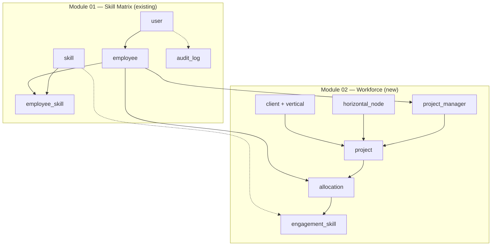
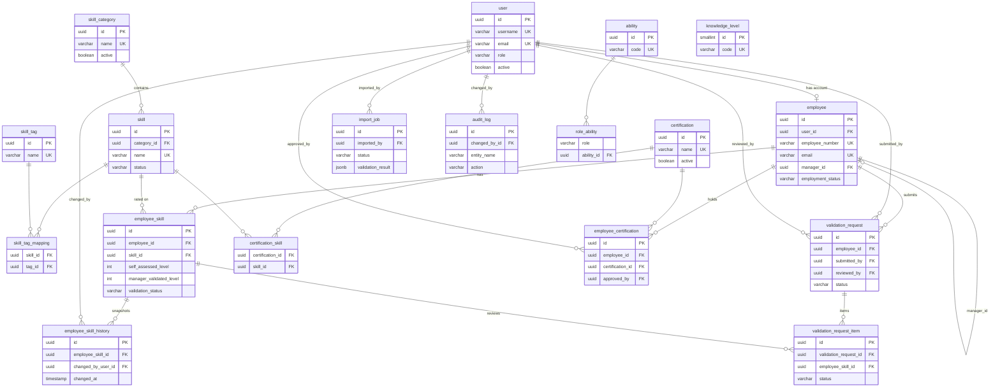
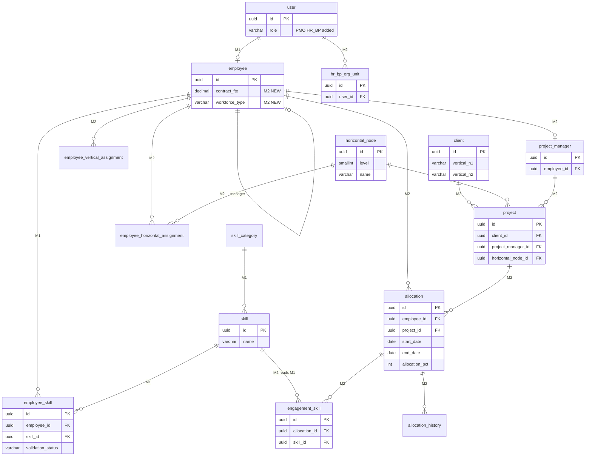
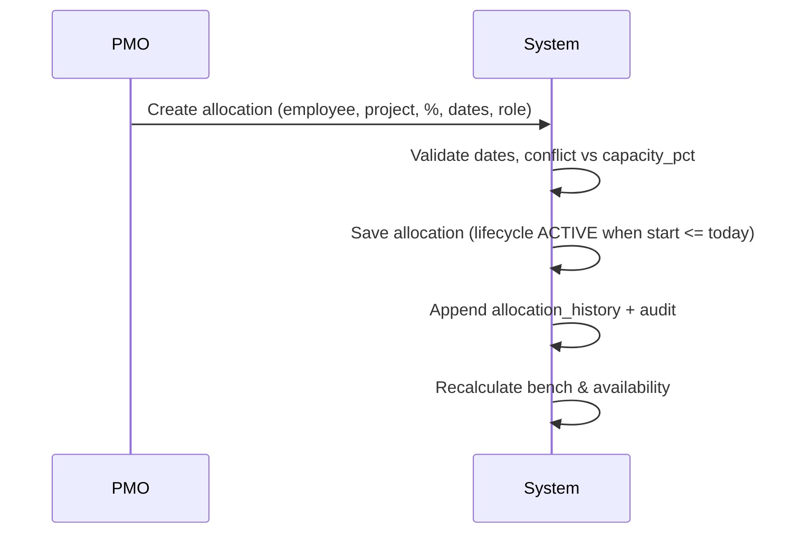

# Module 02 — Database ERD (UML)

Entity-relationship diagrams for **Module 01 (existing)** and **Module 02 (new)**.  
Column details: [`docs/db/data-model.md`](../../db/data-model.md) · [`m2-data-model.md`](./m2-data-model.md)  
**Plain-language guide:** [`m2-data-model-guide.md`](./m2-data-model-guide.md) — start here if you need to explain the diagrams.

**Legend**
- 🟦 Blue group = Module 01 (existing)
- 🟩 Green group = Module 02 (new)
- 🟨 Yellow = M1 table **extended** by M2
- Dashed cross-group arrows = M2 reads M1 data (FK)

---

## What changes (short)

Module 02 adds **workforce allocation** on top of the existing skill matrix. We keep all Module 01 tables and add **16 new ones** (**34 tables total** in MVP). Only **2 existing tables change**: `employee` gets contract capacity (FTE) and person type; `user` gets two new roles (PMO, HR Business Partner).

**Nothing is stored for bench/availability or allocation lifecycle** — both are calculated from dates + FTE.

> **Out of scope:** Staffing requests, candidate matching, leave requests, and capacity forecasting — deferred to a later module. See [epic-05-staffing.md](./epic-05-staffing.md), [epic-07-leave-capacity.md](./epic-07-leave-capacity.md).

### Changes to existing tables

| Table | What we add | What it stores |
|-------|-------------|----------------|
| `employee` | `contract_fte`, `workforce_type` | How much capacity someone has (e.g. 0.8 = 80%) and whether they are Employee / B2B / Supplier |
| `user` | roles `PMO`, `HR_BUSINESS_PARTNER` | Who can manage workforce vs skills |

### New tables — what each stores

| Table | Data stored |
|-------|-------------|
| `hr_bp_org_unit` | Which org unit each HR Business Partner is responsible for |
| `horizontal_node` | Horizontal org tree (BU → Practice → Team, depth 2–3) |
| `employee_horizontal_assignment` | Employee membership in a horizontal node (with start/end dates) |
| `employee_vertical_assignment` | Employee membership in a vertical sector (with start/end dates) |
| `project_manager` | Project Manager profile (links to `employee`) |
| `client` | Customer + vertical classification (`vertical_n1`, `vertical_n2`) |
| `project` | Project: client, PM, horizontal node, dates, status |
| `allocation` | Who works on which project, at what %, in what role, from when to when |
| `allocation_history` | Immutable log of every change to an allocation (% dates, who, why) |
| `allocation_comment` | Permanent notes on an assignment (cannot be edited or deleted) |
| `engagement_skill` | Skills actually used on a project engagement (recorded by Line Manager) |
| `employee_workforce_profile` | Seniority / salary-range codes per employee (from Excel or Workday) |
| `workflow_request` | LM requests needing HR BP / PMO approval (release, allocation change, etc.) |
| `workflow_approval` | Who approved or rejected each workflow step |
| `notification` | In-app alerts (bench warnings, workflow updates, idle escalations) |
| `integration_event_outbox` | Events for Module 05 CV generation when engagement skills are saved |

**Computed (not stored):** allocation lifecycle (`PIPELINE` / `ACTIVE` / `TERMINATED` from dates); bench & availability.

### What Module 01 still owns

Skills, employee skill profiles, validation workflow, certifications, and M1 audit log stay in Module 01. Module 02 **FKs to M1 `skill`** for engagement skills only — it does not read `employee_skill` for matching in this scope.

---

## 1. High-level — how M1 and M2 connect



**Org model:** Vertical on `client`. Horizontal via `horizontal_node` + `employee_horizontal_assignment`. PM via `project_manager` → `employee`.

---

## 2. Module 01 — existing tables (full ERD)



---

## 3. Module 02 — new tables (full ERD)

```mermaid
erDiagram
    user {
        uuid id PK
        varchar role
    }

    employee {
        uuid id PK
        decimal contract_fte "NEW"
        varchar workforce_type "NEW"
        varchar organization_unit
    }

    skill {
        uuid id PK
        varchar name
    }

    hr_bp_org_unit {
        uuid id PK
        uuid user_id FK
        varchar organization_unit
    }

    horizontal_node {
        uuid id PK
        uuid parent_id FK
        smallint level
        varchar name
        varchar code
    }

    employee_horizontal_assignment {
        uuid id PK
        uuid employee_id FK
        uuid horizontal_node_id FK
        date start_date
        date end_date
    }

    employee_vertical_assignment {
        uuid id PK
        uuid employee_id FK
        varchar vertical_n1
        varchar vertical_n2
        date start_date
        date end_date
    }

    project_manager {
        uuid id PK
        uuid employee_id FK UK
        text notes
        boolean active
    }

    client {
        uuid id PK
        varchar name
        varchar vertical_n1
        varchar vertical_n2
        varchar status
    }

    project {
        uuid id PK
        uuid client_id FK
        uuid project_manager_id FK
        uuid horizontal_node_id FK
        varchar name
        varchar code UK
        varchar status
        date start_date
        date end_date
    }

    allocation {
        uuid id PK
        uuid employee_id FK
        uuid project_id FK
        varchar role_name
        int allocation_pct
        date start_date
        date end_date
        boolean override_flag
        uuid created_by FK
        uuid updated_by FK
    }

    allocation_history {
        uuid id PK
        uuid allocation_id FK
        jsonb previous_values
        jsonb new_values
        uuid changed_by FK
        text reason
    }

    allocation_comment {
        uuid id PK
        uuid allocation_id FK
        uuid author_id FK
        text comment_text
    }

    engagement_skill {
        uuid id PK
        uuid allocation_id FK
        uuid skill_id FK
        varchar level_used
        boolean primary_skill
        uuid recorded_by FK
    }

    employee_workforce_profile {
        uuid id PK
        uuid employee_id FK
        varchar seniority_code
        date effective_date
        varchar source
    }

    workflow_request {
        uuid id PK
        varchar type
        varchar status
        uuid submitted_by FK
        jsonb payload
    }

    workflow_approval {
        uuid id PK
        uuid workflow_request_id FK
        uuid approver_id FK
        varchar decision
    }

    notification {
        uuid id PK
        uuid user_id FK
        varchar type
        varchar priority
        timestamp read_at
    }

    integration_event_outbox {
        uuid id PK
        varchar event_type
        jsonb payload
        timestamp processed_at
    }

    user ||--o{ hr_bp_org_unit : "HR BP scope"
    horizontal_node ||--o| horizontal_node : "parent"
    employee ||--o{ employee_horizontal_assignment : "horizontal"
    horizontal_node ||--o{ employee_horizontal_assignment : "member of"
    employee ||--o{ employee_vertical_assignment : "vertical"
    employee ||--o| project_manager : "PM profile"
    client ||--o{ project : "owns"
    project_manager ||--o{ project : "manages"
    horizontal_node ||--o{ project : "owns horizontally"
    project ||--o{ allocation : "staffed by"
    employee ||--o{ allocation : "assigned"
    allocation ||--o{ allocation_history : "append-only"
    allocation ||--o{ allocation_comment : "append-only"
    user ||--o{ allocation_history : "changed_by"
    user ||--o{ allocation_comment : "author"
    user ||--o{ allocation : "created_by"
    allocation ||--o{ engagement_skill : "skills used"
    skill ||--o{ engagement_skill : "M1 FK"
    user ||--o{ engagement_skill : "recorded_by"
    employee ||--o{ employee_workforce_profile : "seniority"
    user ||--o{ workflow_request : "submitted_by"
    workflow_request ||--o{ workflow_approval : "decisions"
    user ||--o{ workflow_approval : "approver"
    user ||--o{ notification : "recipient"
```

> **Allocation lifecycle** (`PIPELINE` / `ACTIVE` / `TERMINATED`) is derived from `start_date` / `end_date` — not stored. See [m2-data-model.md](./m2-data-model.md).

---

## 4. Combined view — M1 ↔ M2 bridge tables

This is the diagram to use in reviews: **what exists, what is new, and where they touch.**



---

## 5. Complete ERD — all in-scope tables (M1 + M2)

**34 tables** — every table in the MVP database. M1 = Module 01 (existing or extended) · M2 = Module 02 (new).

> Deferred tables (`staffing_request*`, `leave_request`) are **not** included.  
> For a less dense view, use §2 (M1 only), §3 (M2 only), or §4 (bridge tables).

```mermaid
erDiagram
    user {
        uuid id PK "M1"
        varchar role "M1 + PMO HR_BP"
    }

    ability {
        uuid id PK "M1"
    }

    role_ability {
        varchar role "M1"
        uuid ability_id FK
    }

    employee {
        uuid id PK "M1 extended"
        uuid user_id FK
        uuid manager_id FK
        decimal contract_fte "M2 NEW"
        varchar workforce_type "M2 NEW"
        varchar employment_status
    }

    skill_category {
        uuid id PK "M1"
    }

    skill {
        uuid id PK "M1"
        uuid category_id FK
    }

    skill_tag {
        uuid id PK "M1"
    }

    skill_tag_mapping {
        uuid skill_id FK "M1"
        uuid tag_id FK
    }

    knowledge_level {
        smallint id PK "M1"
    }

    employee_skill {
        uuid id PK "M1"
        uuid employee_id FK
        uuid skill_id FK
    }

    employee_skill_history {
        uuid id PK "M1"
        uuid employee_skill_id FK
        uuid changed_by_user_id FK
    }

    validation_request {
        uuid id PK "M1"
        uuid employee_id FK
        uuid submitted_by FK
        uuid reviewed_by FK
    }

    validation_request_item {
        uuid id PK "M1"
        uuid validation_request_id FK
        uuid employee_skill_id FK
    }

    certification {
        uuid id PK "M1"
    }

    certification_skill {
        uuid certification_id FK "M1"
        uuid skill_id FK
    }

    employee_certification {
        uuid id PK "M1"
        uuid employee_id FK
        uuid certification_id FK
        uuid approved_by FK
    }

    import_job {
        uuid id PK "M1"
        uuid imported_by FK
    }

    audit_log {
        uuid id PK "M1"
        uuid changed_by_id FK
    }

    hr_bp_org_unit {
        uuid id PK "M2"
        uuid user_id FK
    }

    horizontal_node {
        uuid id PK "M2"
        uuid parent_id FK
        smallint level
        varchar name
    }

    employee_horizontal_assignment {
        uuid id PK "M2"
        uuid employee_id FK
        uuid horizontal_node_id FK
        date start_date
        date end_date
    }

    employee_vertical_assignment {
        uuid id PK "M2"
        uuid employee_id FK
        varchar vertical_n1
        varchar vertical_n2
        date start_date
        date end_date
    }

    project_manager {
        uuid id PK "M2"
        uuid employee_id FK
    }

    client {
        uuid id PK "M2"
        varchar vertical_n1
        varchar vertical_n2
    }

    project {
        uuid id PK "M2"
        uuid client_id FK
        uuid project_manager_id FK
        uuid horizontal_node_id FK
    }

    allocation {
        uuid id PK "M2"
        uuid employee_id FK
        uuid project_id FK
        date start_date
        date end_date
        int allocation_pct
        uuid created_by FK
        uuid updated_by FK
    }

    allocation_history {
        uuid id PK "M2"
        uuid allocation_id FK
        uuid changed_by FK
    }

    allocation_comment {
        uuid id PK "M2"
        uuid allocation_id FK
        uuid author_id FK
    }

    engagement_skill {
        uuid id PK "M2"
        uuid allocation_id FK
        uuid skill_id FK
        uuid recorded_by FK
    }

    employee_workforce_profile {
        uuid id PK "M2"
        uuid employee_id FK
        date effective_date
    }

    workflow_request {
        uuid id PK "M2"
        uuid submitted_by FK
    }

    workflow_approval {
        uuid id PK "M2"
        uuid workflow_request_id FK
        uuid approver_id FK
    }

    notification {
        uuid id PK "M2"
        uuid user_id FK
    }

    integration_event_outbox {
        uuid id PK "M2"
        varchar event_type
    }

    user ||--o| employee : "account"
    employee ||--o| employee : "manager"
    ability ||--o{ role_ability : ""
    skill_category ||--o{ skill : "contains"
    skill ||--o{ skill_tag_mapping : ""
    skill_tag ||--o{ skill_tag_mapping : ""
    employee ||--o{ employee_skill : "profile"
    skill ||--o{ employee_skill : "rated on"
    employee_skill ||--o{ employee_skill_history : "history"
    user ||--o{ employee_skill_history : "changed_by"
    employee ||--o{ validation_request : "submits"
    user ||--o{ validation_request : "submitted_by"
    user ||--o{ validation_request : "reviewed_by"
    validation_request ||--o{ validation_request_item : "items"
    employee_skill ||--o{ validation_request_item : "reviews"
    certification ||--o{ certification_skill : ""
    skill ||--o{ certification_skill : ""
    employee ||--o{ employee_certification : "holds"
    certification ||--o{ employee_certification : ""
    user ||--o{ employee_certification : "approved_by"
    user ||--o{ import_job : "imported_by"
    user ||--o{ audit_log : "changed_by"
    user ||--o{ hr_bp_org_unit : "HR BP scope"
    horizontal_node ||--o| horizontal_node : "parent"
    employee ||--o{ employee_horizontal_assignment : "horizontal"
    horizontal_node ||--o{ employee_horizontal_assignment : ""
    employee ||--o{ employee_vertical_assignment : "vertical"
    employee ||--o| project_manager : "PM profile"
    client ||--o{ project : "owns"
    project_manager ||--o{ project : "manages"
    horizontal_node ||--o{ project : "horizontal owner"
    project ||--o{ allocation : "staffed by"
    employee ||--o{ allocation : "assigned"
    allocation ||--o{ allocation_history : "append-only"
    allocation ||--o{ allocation_comment : "append-only"
    user ||--o{ allocation_history : "changed_by"
    user ||--o{ allocation_comment : "author"
    user ||--o{ allocation : "created_by"
    user ||--o{ allocation : "updated_by"
    allocation ||--o{ engagement_skill : "skills used"
    skill ||--o{ engagement_skill : "M1 catalog FK"
    user ||--o{ engagement_skill : "recorded_by"
    employee ||--o{ employee_workforce_profile : "seniority"
    user ||--o{ workflow_request : "submitted_by"
    workflow_request ||--o{ workflow_approval : "decisions"
    user ||--o{ workflow_approval : "approver"
    user ||--o{ notification : "recipient"
```



---

## 6. Table inventory

### Module 01 — unchanged (18 tables)

| Table | Domain |
|-------|--------|
| `user` | Auth |
| `ability`, `role_ability` | RBAC (reserved) |
| `employee` | People |
| `skill_category`, `skill`, `skill_tag`, `skill_tag_mapping` | Skill catalog |
| `knowledge_level` | Level lookup |
| `employee_skill`, `employee_skill_history` | Skills & history |
| `validation_request`, `validation_request_item` | Validation workflow |
| `certification`, `certification_skill`, `employee_certification` | Certifications |
| `import_job` | M1 Excel import |
| `audit_log` | Audit trail |

### Module 01 — extended by M2

| Table | Change |
|-------|--------|
| `employee` | + `contract_fte`, + `workforce_type` |
| `user` | + roles `PMO`, `HR_BUSINESS_PARTNER` |

### Module 02 — new (16 tables)

| Table | Domain | Migration |
|-------|--------|-----------|
| `hr_bp_org_unit` | HR BP scope | `011` |
| `horizontal_node` | Horizontal org tree | `012` |
| `employee_horizontal_assignment` | Employee ↔ horizontal (dated) | `012` |
| `employee_vertical_assignment` | Employee ↔ vertical (dated) | `012` |
| `project_manager` | PM profile → employee | `012` |
| `client` | Clients + vertical_n1/n2 | `012` |
| `project` | Projects (client, PM, horizontal) | `012` |
| `allocation` | Assignments | `013` |
| `allocation_history` | Assignment audit | `013` |
| `allocation_comment` | Assignment notes | `013` |
| `engagement_skill` | Per-project skills | `014` |
| `integration_event_outbox` | M05 events | `014` |
| `employee_workforce_profile` | Seniority codes | `015` |
| `workflow_request` | Governance | `016` |
| `workflow_approval` | Governance | `016` |
| `notification` | Alerts | `016` |

### Out of scope — deferred tables

| Table | Domain | Reference |
|-------|--------|-----------|
| `staffing_request`, `staffing_request_skill`, `staffing_candidate` | Staffing & matching | [epic-05-staffing.md](./epic-05-staffing.md) |
| `leave_request` | Leave & capacity | [epic-07-leave-capacity.md](./epic-07-leave-capacity.md) |

### Computed — no table

| Concept | Service / rule |
|---------|----------------|
| `available_pct`, bench status | `AvailabilityService` |
| Allocation lifecycle (`PIPELINE` / `ACTIVE` / `TERMINATED`) | `AllocationService` from dates |

---

## 7. Core relationship chains

**Project → allocation**
```
client (vertical) → project ← project_manager ← employee
                  ↘ horizontal_node
project → allocation → employee
```

**Org structure → people**
```
horizontal_node ← employee_horizontal_assignment → employee
client.vertical_n1/n2 ← employee_vertical_assignment → employee (dated)
```

**Skills flow (M1 → M2)**
```
skill ← engagement_skill           (what was used on the project)
```

**People & capacity**
```
employee.contract_fte → capacity_pct
employee → allocation (ACTIVE lifecycle only) → allocated_pct
```

**Governance**
```
user (LM) → workflow_request → workflow_approval → user (HR BP / PMO)
user → notification
```

---

## 8. Core business flow — assign & update availability

PMO assigns a person directly to a project → bench and availability update automatically.



| Step | What happens | Tables / services |
|------|----------------|-------------------|
| 1 | PMO picks employee, project, and PM if new project | `allocation`, `project`, `project_manager` |
| 2 | System checks overallocation vs FTE | `contract_fte`, `AvailabilityService` |
| 3 | Allocation saved | `allocation`, `allocation_history` |
| 4 | Lifecycle derived from dates | `PIPELINE` / `ACTIVE` / `TERMINATED` |
| 5 | Bench and availability refresh | computed — no write |

> Staffing requests, candidate matching, and leave management are **out of scope** for Module 02 MVP.

---

## Viewing the diagrams

- **GitHub / GitLab / Cursor** — Mermaid renders in markdown preview
- **VS Code** — install "Markdown Preview Mermaid Support"
- **Export to image** — paste into [mermaid.live](https://mermaid.live) or use `mmdc` CLI
