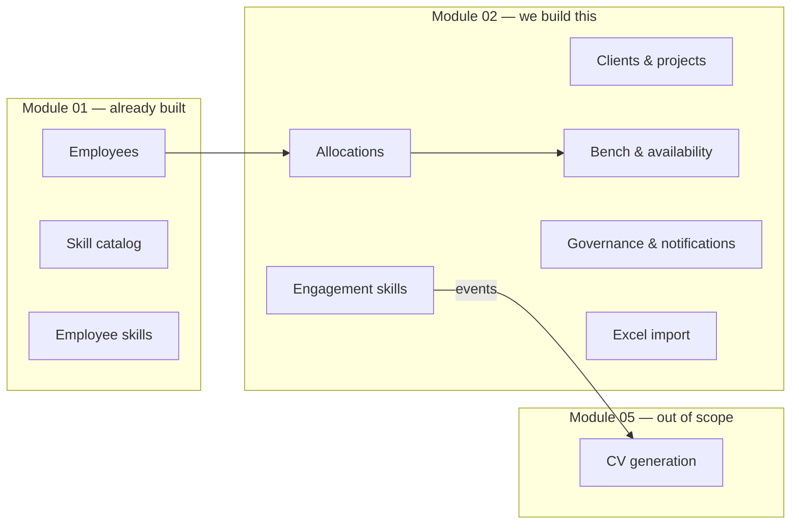
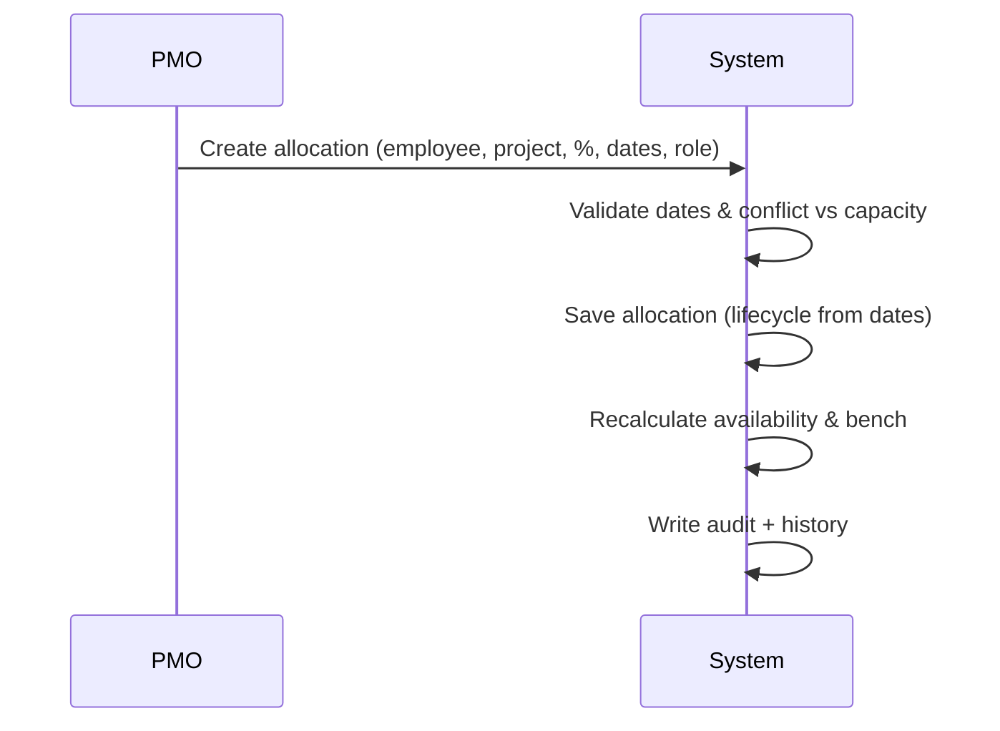
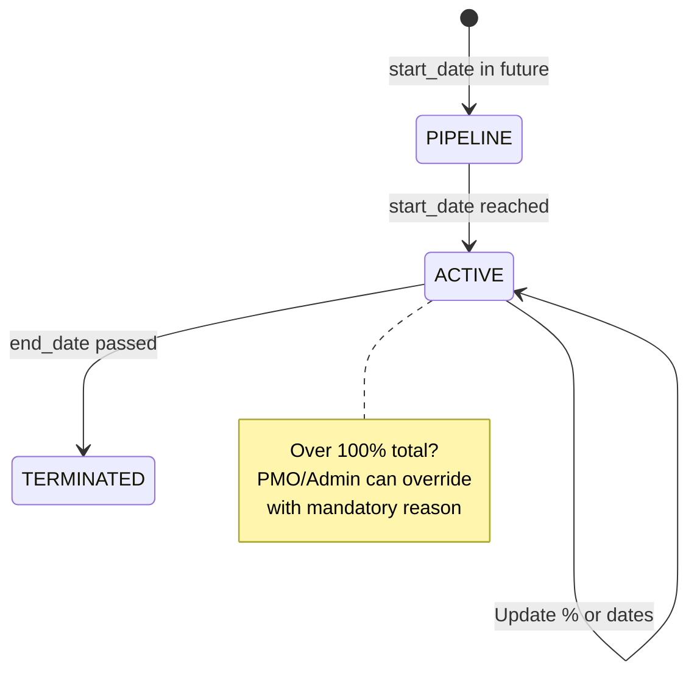
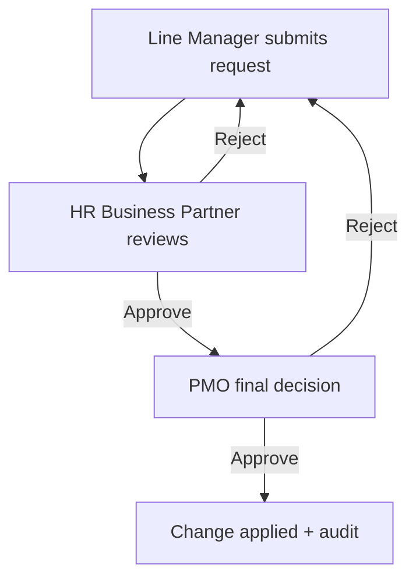
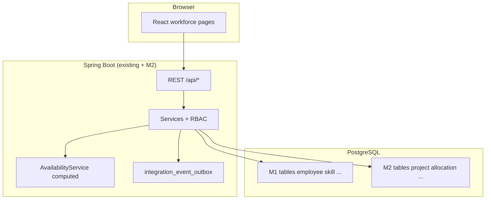

# Module 02 — What We Are Building (Kickoff Brief)

---

## In one sentence

We replace Excel-based workforce allocation with a web app where PMO can see **who is available**, **assign people to projects**, **track bench**, and **keep a full audit history** — all role-gated and deployable as one unit with Module 01.

> **Out of scope for MVP:** Staffing requests & candidate matching, leave requests & capacity forecasting.

---

## The problem today

| Pain | What happens |
|------|----------------|
| No single source of truth | Multiple Excel files, different formats, different owners |
| Bench is invisible until too late | No live view of who is free or about to be free |
| No history | Assignment changes are overwritten or lost |
| Duplicate work | Same data entered in several places |

---

## The solution (Module 02 scope)



**We build only what is in `optimal-spec.md`.** We do **not** build Modules 03, 04, 05, or 06.

| In scope (M2) | Out of scope (later modules) |
|---------------|------------------------------|
| Clients & projects | Demand management (M3) |
| Allocations (% + dates + history) | Search & discovery (M4) |
| Bench & availability views | CV generation UI (M5) |
| Per-engagement skills (LM records) | Reports & analytics (M6) |
| Governance workflows (LM → HR BP → PMO) | Staffing requests & candidate matching |
| Excel import wizard | Leave impact on capacity |
| In-app + email notifications | Capacity forecast (3 / 6 / 12 months) |
| Workforce dashboard | |
| Workday sync (CSV/API adapter) | |

---

## Who uses it (6 roles)

| Role | New? | Main job in M2 |
|------|------|----------------|
| **PMO** | Yes | Run workforce: projects, allocations, bench, import |
| **Admin** | No | Full access |
| **Line Manager** | No | Manage direct reports' allocations; record engagement skills |
| **HR Business Partner** | Yes | Org-unit workforce; governance queue |
| **HR** | No | Read-only org-wide view |
| **Employee** | No | See own assignment history only |

> Technical Lead role is **not** in the M2 permission model (per spec).

---

## Core flows (what users actually do)

### Flow 1 — PMO assigns someone to a project



### Flow 2 — Allocation lifecycle



### Flow 3 — Governance (LM-initiated changes)



### Flow 4 — Bench definition (simple rule)

```
On bench = 0% active allocation today
           AND employee is ACTIVE
```

Availability is **calculated**, not stored:

**FTE (Full-Time Equivalent)** — how much of a full-time contract someone has:

| FTE | Meaning |
|-----|---------|
| 1.0 | Full-time (100% capacity) |
| 0.8 | 80% of full-time (e.g. 4 days/week) |
| 0.5 | Half-time (50%) |

```
capacity   = contract FTE × 100        (e.g. 0.8 FTE → 80% max)
allocated  = sum of ACTIVE lifecycle allocations on that date
available  = capacity − allocated
```

Example: 0.8 FTE employee allocated 60% → **20% available** (not 40%), because their max is 80%.

---

## What we deliver (feature checklist)

### Week 1 — operational core
- [ ] Foundation: new roles (PMO, HR BP), contract FTE (Full-Time Equivalent) & workforce type
- [ ] Clients (vertical on client) & horizontal org tree & project managers
- [ ] Projects: client + PM + horizontal node
- [ ] Allocations: create, update, end, comments, full history
- [ ] Conflict detection + PMO override with mandatory note
- [ ] Bench dashboard (now / 15 days / 30 days)
- [ ] Availability search

### Week 2 — skills, governance, go-live
- [ ] Engagement skills on allocations (LM records; feeds M05 via outbox)
- [ ] Governance inbox + SLA alerts
- [ ] Excel import wizard (validate before commit)
- [ ] Notifications (in-app + email)
- [ ] Podman deploy + demo + acceptance sign-off

**Team:** 2 full-stack developers · **Timeline:** 10 working days

---

## How it connects to Module 01

| M2 needs from M1 | M2 gives back |
|------------------|---------------|
| Employee records | Allocation & bench data |
| Skill catalog | Per-engagement skill events (for M05 CV) |
| Validated employee skills | Audit trail for workforce changes |

M1 may need small refactors (new columns on `employee`, new roles) — that is expected and documented in [`m1-refactor-inventory.md`](./m1-refactor-inventory.md).

---

## Success criteria (from spec §10 — simplified)

We are done when all of these work:

| Area | Criteria |
|------|----------|
| **Access** | PMO can manage allocations; LM only direct reports; API returns 403 for unauthorized writes |
| **Allocations** | Create with %, dates, role; reject invalid dates; availability updates after assign |
| **Conflicts** | Detect overallocation; block without override; override needs mandatory comment + clear error message |
| **Bench** | Zero allocation = on bench; show capacity/allocated/available |
| **Engagement skills** | LM adds catalog skills only; M05 event on close |
| **Audit** | Every change logged; audit records cannot be edited or deleted |
| **Import** | Row-level validation before commit; re-import does not duplicate |

Full list: spec §10 (23 criteria) · tracked in [`epic-09-deploy.md`](./epic-09-deploy.md)

---

## Questions for this call (2 only) — **resolved**

| # | Decision | Answer |
|---|----------|--------|
| **Q1** | Full approval workflow in MVP? | **Yes** — LM → HR BP → PMO (Epic 08) |
| **Q2** | HR BP multiple org units? | **Yes** — multiple `hr_bp_org_unit` rows per user |

Recorded in [`m2-open-questions.md`](./m2-open-questions.md).

---

## Suggested 30-minute agenda

| Time | Topic |
|------|-------|
| 0–5 min | Problem + one-sentence solution |
| 5–12 min | Walk through core flows diagram (PMO assign, bench, matching) |
| 12–18 min | Roles & who can do what |
| 18–25 min | **Two decisions** — governance workflow (Q1) + HR BP scope (Q2) |
| 25–30 min | Timeline, acceptance criteria, next steps |

**Demo target (end of build):** [`demo-script.md`](./demo-script.md) (~30 min walkthrough)

---

## Architecture at a glance



**Deploy:** single `podman compose up` — same stack as Module 01.

---

## After the call

1. Record decisions in [`m2-open-questions.md`](./m2-open-questions.md)
2. Start implementation on branch `feat/m2-epic-01-foundation`
3. Week 1 checkpoint: allocations + bench working before Week 2 extras

---

## Quick links

| Document | Purpose |
|----------|---------|
| [`optimal-spec.md`](../../../optimal-spec.md) | Business rules & acceptance criteria |
| [`m2-data-model.md`](./m2-data-model.md) | Database tables |
| [`m2-api-scope.md`](./m2-api-scope.md) | All REST endpoints + RBAC |
| [`week-1.md`](./week-1.md) / [`week-2.md`](./week-2.md) | Day-by-day tasks |
| [`demo-script.md`](./demo-script.md) | End-to-end demo script |
