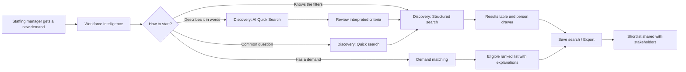
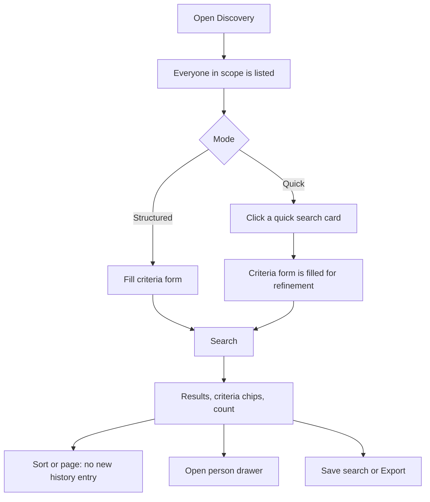
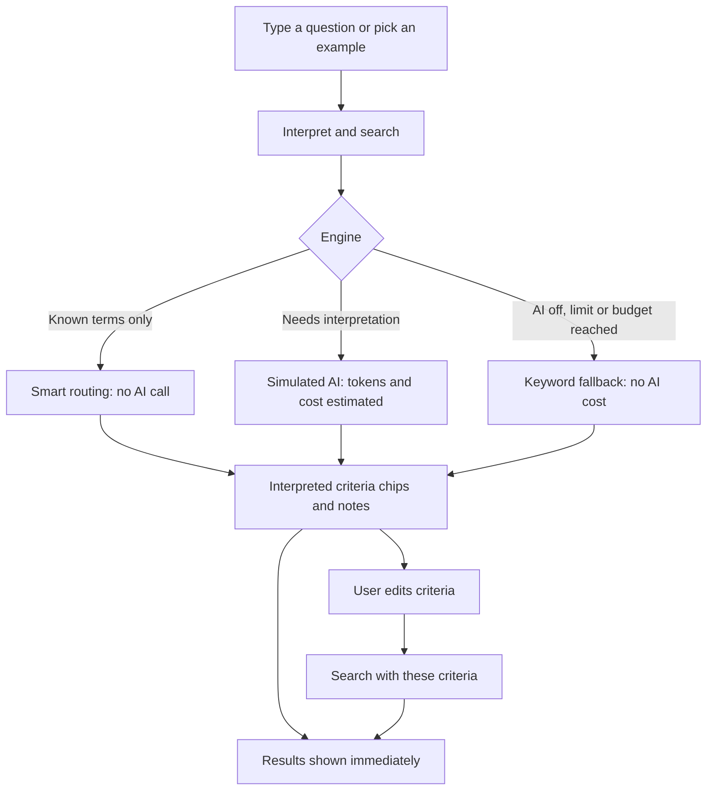
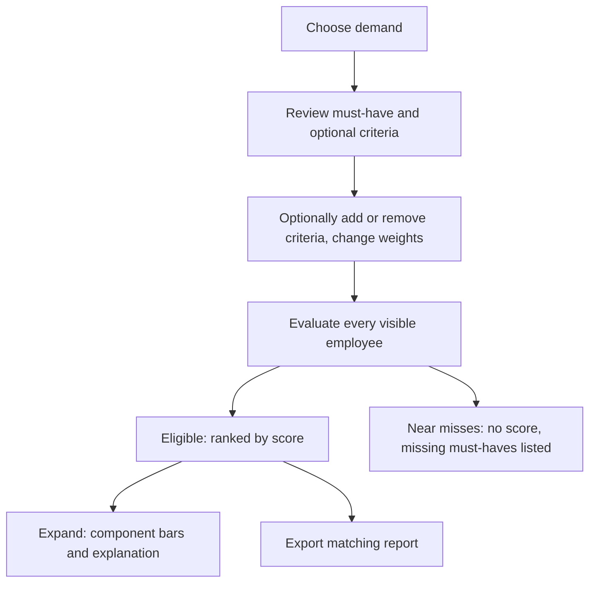
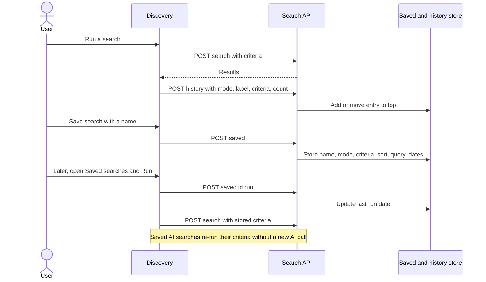

# 03 — UX and User Workflows

## Navigation

A fifth sidebar module, **Workforce Intelligence** (`/intelligence`), sits next to Skill Matrix, Workforce, Demand management and Administration. It reuses the existing module dashboard, sidebar, breadcrumbs (`WorkforcePageHeader`), MUI theme and route guards.

| Item                 | Route                                        | Roles                               |
| -------------------- | -------------------------------------------- | ----------------------------------- |
| Discovery            | `/search`                                    | ADMIN, PMO, HR, HR BP, LINE_MANAGER |
| Dashboard            | `/intelligence/dashboard`                    | above + MANAGEMENT                  |
| Experience analytics | `/intelligence/analytics?tab=tenure\|skills` | above + MANAGEMENT                  |
| Demand matching      | `/intelligence/matching?demand=…`            | ADMIN, PMO, HR BP                   |
| External applicants  | `/intelligence/applicants`                   | ADMIN, PMO, HR BP                   |
| Usage & costs        | `/intelligence/costs`                        | ADMIN, PMO, MANAGEMENT              |

## Main screens

| Screen               | Layout                                                                                                                                                                                                           | Key interactions                                                       |
| -------------------- | ---------------------------------------------------------------------------------------------------------------------------------------------------------------------------------------------------------------- | ---------------------------------------------------------------------- |
| Discovery            | Header with _Saved searches_ / _Recent searches_. Scope chip. Tabs **Structured · Quick · AI Quick Search**. Result toolbar (count, criteria chips, sort, _Save search_, _Export_). Result table. Detail drawer. | Search, clear all, sort by column, paginate, open person, save, export |
| Dashboard            | Filters (unit, thresholds). KPI cards. 6 charts. Demand table.                                                                                                                                                   | Click KPI/bar/segment to drill down                                    |
| Experience analytics | Tabs _Project tenure_ / _Skill experience_. Threshold and filters. KPI. Charts. Project/skill table. Employee table.                                                                                             | Change thresholds, drill down, export                                  |
| Demand matching      | Left: demand editor and weights. Right: criterion builder, eligible list, near misses.                                                                                                                           | Edit criteria, adjust weights, expand breakdown, export                |
| External applicants  | Privacy notice. KPI. 12-month chart. Month selector. Names table.                                                                                                                                                | Click month, export                                                    |
| Usage & costs        | Illustrative-only warning. KPIs. Budget bar. Cost comparison. Requests by type. Daily chart. Pricing form. Explanation.                                                                                          | Admin edits pricing/limits, reset demo usage, export                   |

States: every screen has loading bars, permission errors (403 shows a role message), empty states ("No one matches… remove a criterion"), and warnings (ignored seniority filter, partial data quality).

## Diagram — main user journey (14)

## Search flow (structured / quick)

## AI search flow

## Demand matching flow

## Save and re-run flow (8)

## Export workflow

The user clicks **Export** and picks a format. The screen builds a report from current API data (re-querying with active filters and sort for Discovery). The browser writes the file and downloads it. A toast confirms success or shows the error. See [09](09-export-and-reporting.md) for the sequence diagram.

## Analytics drill-down

| From                                   | Click      | Opens                                                      |
| -------------------------------------- | ---------- | ---------------------------------------------------------- |
| Dashboard KPI "On bench"               | card       | `/search?status=BENCH`                                     |
| Dashboard "Employees by technology"    | bar        | `/search?skill=<id>&level=3`                               |
| Dashboard "Employees by business unit" | bar        | `/search?bu=<id>`                                          |
| Dashboard allocation donut             | segment    | `/search?status=<status>`                                  |
| Dashboard tenure chart                 | any bar    | `/intelligence/analytics?tab=tenure`                       |
| Dashboard demand table                 | row        | `/intelligence/matching?demand=<id>`                       |
| Tenure KPI / project row               | card / row | `/search?tenureMin=N&sort=TENURE` / `/search?project=<id>` |
| Skill KPI / skill row                  | card / row | `/search?skillYearsMin=N` / `/search?skill=<id>`           |
| Employee rows                          | row        | `/search?text=<name>`                                      |

Drill-down links are only active for roles that may search individuals.

## Persona notes

- **HR manager:** analytics tabs, competency distribution, cost-code columns.
- **Staffing manager / PMO:** Quick and AI search, matching, saved searches, exports for client proposals.
- **Project / line manager:** Discovery limited to direct reports, to plan rotation and availability.
- **Executive:** Dashboard, analytics totals and costs. No individual data.
