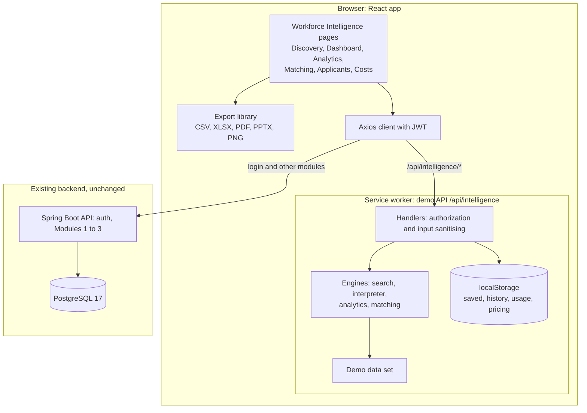
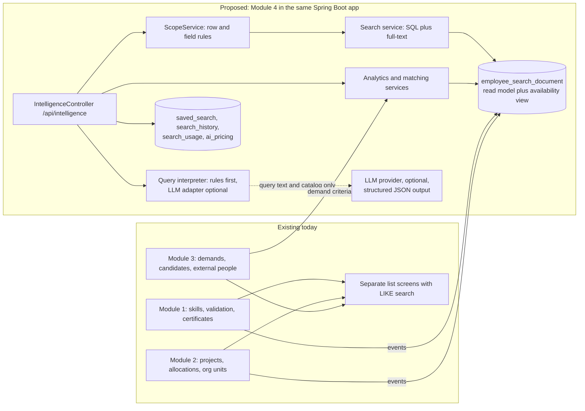
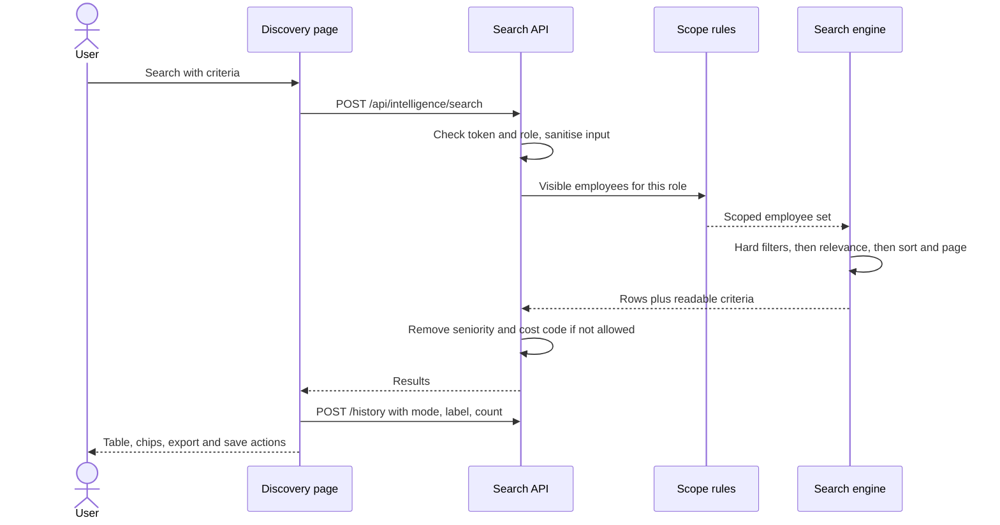
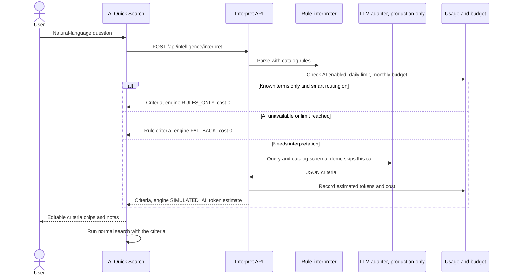
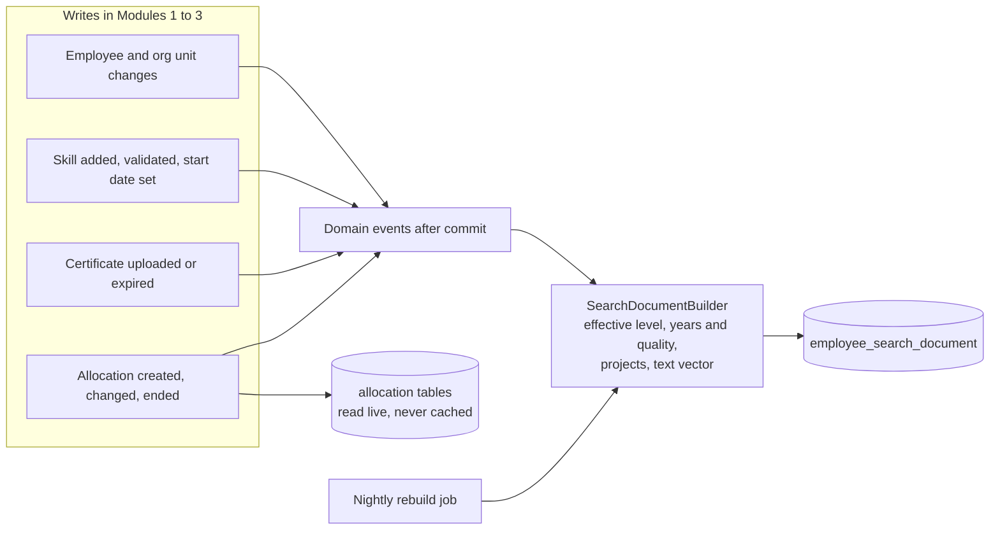

# 04 — Technical Architecture

## 4.1 Current architecture (before this work)

- **Frontend:** React 18 + TypeScript + Vite, MUI 5, React Query, Zustand (auth in `sessionStorage`), React Router 6, Axios with a bearer-token interceptor. MSW mocks the endpoints the backend does not serve yet (Module 3 in dev).
- **Backend:** Spring Boot 3.3 / Java 21, JWT security, `@PreAuthorize` plus row-level checks in services (`ScopeService`, `DemandAccessPolicy`), MapStruct, Liquibase on PostgreSQL 17.
- **Relevant existing data:** `employee`, `employee_skill` (self and validated levels 1–5, validation status), `certificate`, `project`, `allocation` (dates, %), `engagement_skill`, `horizontal_node` (corporate structure), `employee_current_horizontal` view (unit from latest allocation), `demand`, `demand_skill` (must-have flag, required level), `external_person`, `candidate`.
- **Gaps found:**
  - The employee search ignores its skill parameters (TODO in `EmployeeService`).
  - No search across modules.
  - No experience-start date on `employee_skill`.
  - No charts library and no client-side export.
  - No AI integration (Azure OpenAI variables exist in `podman-compose.yml` but are unused).

## 4.2 Changes introduced (implemented in the demo)

| Area                    | Files                                                                                         | Notes                                                                                            |
| ----------------------- | --------------------------------------------------------------------------------------------- | ------------------------------------------------------------------------------------------------ |
| Types (API contract)    | `frontend/src/types/intelligence.types.ts`                                                    | One contract for all Module 4 endpoints                                                          |
| Demo API (mock backend) | `frontend/src/mocks/intelligence{Fixtures,Core,Search,Analytics,Matching,Store,Handlers}.ts`  | MSW handlers under `/api/intelligence/*`; engines are pure functions (unit-tested)               |
| Mock wiring             | `mocks/browser.ts`, `mocks/handlers.ts`, `main.tsx`, `features/search/mockMode.ts`            | Module 4 mocks on in every build until a backend exists (`VITE_USE_SEARCH_MOCKS=false` disables) |
| Feature UI              | `frontend/src/features/intelligence/*`                                                        | API hooks, criteria form, results table, drawers                                                 |
| Pages                   | `pages/SearchDiscovery`, `pages/Intelligence/{Dashboard,Analytics,Matching,Applicants,Costs}` | Lazy-loaded routes                                                                               |
| Shared components       | `components/Charts/Charts.tsx`, `components/ExportMenu/ExportMenu.tsx`                        | Chart primitives without a library; export menu                                                  |
| Export library          | `frontend/src/lib/export/*`                                                                   | Zero-dependency CSV, XLSX, PDF, PPTX, PNG writers                                                |
| Navigation and routes   | `layout/navigation.tsx`, `router/AppRouter.tsx`                                               | New module "Workforce Intelligence"                                                              |
| Hosting                 | `frontend/nginx.conf`                                                                         | `index.html` is never cached, so new builds are picked up                                        |

No backend code, database schema or existing feature was changed. No new npm dependency was added.

## 4.3 Diagram — overall system architecture, demo as built (1)



## 4.4 Diagram — existing versus proposed production architecture (2)



## 4.5 Frontend structure

```
src/
  types/intelligence.types.ts       API contract
  features/intelligence/            hooks, model helpers, CriteriaForm, SearchResults, SearchLibrary
  pages/SearchDiscovery/            Discovery (3 search modes)
  pages/Intelligence/*              Dashboard, Analytics, Matching, Applicants, Costs
  components/Charts, ExportMenu     shared UI
  lib/export/                       report model + format writers
  mocks/intelligence*.ts            demo backend (to be replaced by the real API)
```

## 4.6 Data flow and search architecture

1. The page sends criteria (`SearchFilters`) to `POST /api/intelligence/search`.
2. The handler authenticates (the bearer token must equal the session token), resolves the role scope, and sanitises input (unknown ids dropped, ranges clamped).
3. `visibleProfiles(scope)` applies row-level rules **first**.
4. Hard filters run, then relevance and sort, then pagination.
5. Field-level redaction (seniority, cost code) is applied before returning.
6. A user-initiated run then calls `POST /history`, which records history (criteria only) and usage.

## 4.7 Diagram — search request lifecycle (3)



## 4.8 AI integration boundaries

- **AI only translates the query into criteria.** It never selects, scores or sees employees. Results always come from the permission-aware search.
- **Input to the model:** the user's query plus the catalog (skill, unit, industry and project names, filter schema). **No personal data.**
- **Output:** JSON validated against `SearchFilters` (the same sanitiser the API uses). Invalid output falls back to keyword rules.
- **Demo:** `parseQuery()` in `intelligenceSearch.ts` plays the model's role deterministically. Production keeps it as stage 1 (smart routing / fallback) and adds an `LlmInterpreter` adapter behind a feature flag.

## 4.9 Diagram — AI Quick Search lifecycle (4)



## 4.10 Indexing strategy (proposed for production)

The demo computes everything from in-memory data. Production should keep PostgreSQL as the only store (no Elasticsearch needed at this scale, roughly 500 to 20,000 people):

- `employee_search_document`: one row per active employee with business unit, team, location, seniority, skills JSONB (`level`, `validated`, `since`, `quality`), skill id arrays (GIN), project and client names, and a weighted `tsvector` plus `pg_trgm` index for text and typos.
- Availability is **not** cached. It is computed per request from `allocation` (and Module 3 confirmed placements) because it depends on the requested date.
- Refreshed in the same transaction by Spring `@TransactionalEventListener` on employee, skill, validation, certificate, allocation and project changes. A nightly full rebuild repairs drift.

## 4.11 Diagram — employee and skill indexing flow (5, proposed)



## 4.12 Permissions

See [10](10-security-and-permissions.md). Summary: role check, then row scope, then field redaction, then response. Exports and analytics use the same API.

## 4.13 Export architecture

Client-side writers in `lib/export` produce files from a `Report` object (title, criteria, KPIs, charts, tables). XLSX and PPTX are Office Open XML packages written with a minimal ZIP writer. PDF is hand-written PDF 1.4 with standard fonts and JPEG chart images. PNG is rendered on a canvas. Production can keep this, or move large exports to the backend (Apache POI already exists there). See [09](09-export-and-reporting.md).

## 4.14 Cost monitoring

Every interpretation and run is recorded as a usage event (`kind`, tokens, estimated cost, user, time). The demo stores events in `localStorage`. Production uses a `search_usage` table plus provider-reported token counts. See [08](08-cost-and-usage.md).
