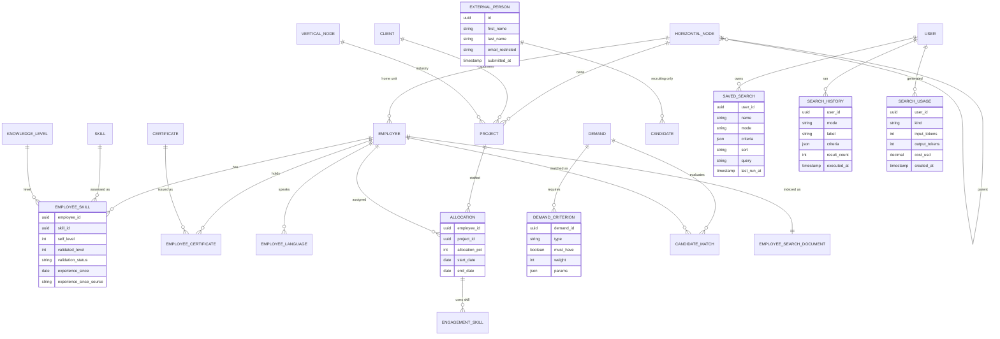

# 05 — Data Model

Existing tables are reused. Only the additions marked **New** are proposed for production. In the demo, the same shapes exist as TypeScript types (`intelligence.types.ts`) and demo records (`intelligenceFixtures.ts`).

## 5.1 Entities

| Entity                                              | Status                                                         | Key attributes                                                                                                            | Notes                                              |
| --------------------------------------------------- | -------------------------------------------------------------- | ------------------------------------------------------------------------------------------------------------------------- | -------------------------------------------------- |
| Internal employee (`employee`)                      | Existing                                                       | id, name, title, location, manager_id, employment_status, workforce_type, contract_fte, cost_code                         | Only `ACTIVE` are searchable                       |
| Organisation unit (`horizontal_node`)               | Existing                                                       | id, name, parent_id                                                                                                       | Level 1 = business unit, level 2 = team/department |
| Employee unit                                       | Existing view + **New column**                                 | `employee_current_horizontal`; **new** `employee.home_horizontal_node_id`                                                 | Fallback for people without allocations            |
| Skill (`skill`, `skill_category`)                   | Existing                                                       | id, name, category                                                                                                        | Technologies are skills                            |
| Competency level (`knowledge_level`)                | Existing                                                       | 1 Beginner … 5 Master                                                                                                     |                                                    |
| Employee skill (`employee_skill`)                   | Existing + **New columns**                                     | self/validated level, validation_status; **new** `experience_since DATE`, `experience_since_source` (RECORDED, ESTIMATED) | `updated_at` is never used as experience start     |
| Certificate (`certificate`, `certificate_skill`)    | Existing                                                       | code, expiration_date, skills                                                                                             | Valid = not expired                                |
| Language                                            | **New** `employee_language`                                    | employee_id, language, level (CEFR)                                                                                       | Optional criterion                                 |
| Project (`project`, `client`, `vertical_node`)      | Existing                                                       | name, client, industry                                                                                                    |                                                    |
| Project assignment / allocation (`allocation`)      | Existing                                                       | employee_id, project_id, role, allocation_pct, start_date, end_date                                                       | Tenure and availability source                     |
| Engagement skill (`engagement_skill`)               | Existing                                                       | allocation_id, skill_id, primary                                                                                          | Experience evidence                                |
| Staffing demand (`demand`)                          | Existing                                                       | code, title, start date, allocation %                                                                                     |                                                    |
| Must-have / optional criterion                      | Existing `demand_skill.must_have` + **New** `demand_criterion` | type (SKILL, CERTIFICATION, INDUSTRY, PROJECT_EXPERIENCE, LANGUAGE), params JSONB, must_have, weight 1–5                  | Generalises skill-only criteria                    |
| Candidate match                                     | **New (computed)**                                             | demand_id, employee_id, eligible, score, components                                                                       | Not stored by default; snapshot optional (Q9)      |
| External applicant (`external_person` / recruiting) | Existing + **New column**                                      | first/last name, email (restricted), `submitted_at`                                                                       | Never joined to employee search                    |
| Saved search                                        | **New** `saved_search`                                         | id, user_id, name, mode, criteria JSONB, sort, query, created_at, updated_at, last_run_at                                 | Unique (user_id, lower(name))                      |
| Search history                                      | **New** `search_history`                                       | id, user_id, mode, label, query, criteria JSONB, sort, result_count, executed_at                                          | Keep last 25 per user, 90-day retention            |
| Search usage                                        | **New** `search_usage`                                         | id, user_id, kind, input_tokens, output_tokens, cost_usd, model, created_at                                               | Append-only                                        |
| AI pricing / limits                                 | **New** `ai_pricing_config`                                    | model, prices, budget, daily_limit, ai_enabled, smart_routing, valid_from                                                 | Admin-managed, versioned                           |
| Search read model                                   | **New** `employee_search_document`                             | employee_id PK, unit ids, skills JSONB, skill_ids UUID[], text_vector tsvector                                            | Rebuilt from events                                |

## 5.2 Diagram — entity relationships (13)

## 5.3 Constraints and rules

- `employee_skill.experience_since <= CURRENT_DATE`. Source `ESTIMATED` is set only by the backfill job (earliest `allocation.start_date` with an `engagement_skill` for that skill). A user-entered date replaces it with `RECORDED`.
- `demand_criterion.weight BETWEEN 1 AND 5`. Must-have rows ignore weight.
- `saved_search`: unique `(user_id, lower(name))`, maximum 50 per user (service rule).
- `search_history` and `search_usage` are append-only. Search history is trimmed per user, and usage is kept 13 months for trend reporting.
- `external_person.submitted_at` is immutable after insert. Monthly counts use it, never `updated_at`.
- Follow the repository conventions: UUID PKs, `VARCHAR + CHECK` for enums, plain `TIMESTAMP`, `updated_at` via `@PreUpdate`, Liquibase changesets with rollback.

## 5.4 Indexes (production)

| Table                      | Index                                                                                                | Purpose                                |
| -------------------------- | ---------------------------------------------------------------------------------------------------- | -------------------------------------- |
| `allocation`               | `(employee_id, start_date, end_date)`                                                                | Availability and tenure                |
| `allocation`               | `(project_id) WHERE end_date IS NULL OR end_date >= CURRENT_DATE`                                    | Current members                        |
| `employee_skill`           | `(skill_id, validated_level)`                                                                        | Skill filters                          |
| `employee_search_document` | GIN on `skill_ids`, GIN on `text_vector`, GIN trigram on `search_text`, B-tree on `business_unit_id` | Hybrid search                          |
| `saved_search`             | `(user_id, updated_at DESC)`                                                                         | Drawer list                            |
| `search_history`           | `(user_id, executed_at DESC)`                                                                        | Drawer list                            |
| `search_usage`             | `(created_at)`, `(user_id, created_at)`                                                              | Monthly and daily cost, per-user limit |
| `external_person`          | `(submitted_at)`                                                                                     | Monthly applicant count                |

## 5.5 Demo data set

26 internal employees (24 active, 1 new hire, 1 inactive) across 5 business units and 9 teams; 17 projects in 5 industries. Data covers:

- current tenures from 0.2 to 4.1 years
- skill experience from estimated and unknown up to 13.7 years
- all competency levels
- bench, partial and full allocation
- 4 demands with qualified and unqualified matches
- 75 applicants over 12 months, with later edits that must not change the month

Values are fixed offsets from today, so analytics are stable between renders.
