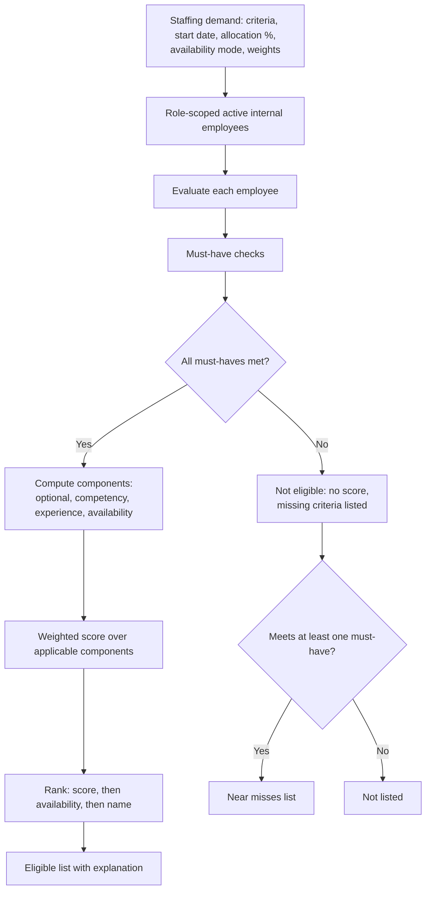

# 06 — Search and Ranking Specification

## 6.1 Search types

| Type                 | What it does                                                                                                   | Demo                             | Production                                                        |
| -------------------- | -------------------------------------------------------------------------------------------------------------- | -------------------------------- | ----------------------------------------------------------------- |
| Structured           | Exact filters on ids, levels, dates, percentages                                                               | Implemented                      | SQL predicates on the read model plus the live availability query |
| Keyword              | Name, title, project, client, role, skill text. Every token must match. Tokens of 5+ letters tolerate one typo | Implemented (in-memory)          | PostgreSQL `tsvector` + `pg_trgm`                                 |
| Semantic             | Meaning-based similarity ("cloud native" ≈ Kubernetes, Docker)                                                 | **Not implemented**              | Optional `pgvector` on profile summaries (Phase 3)                |
| Hybrid               | Hard filters first, then a weighted relevance mixing structured fit and text/semantic similarity               | Structured relevance implemented | Add a text-rank / vector-similarity component                     |
| Query interpretation | Natural language to `SearchFilters`                                                                            | Rule engine simulating AI        | Rules first, LLM with JSON-schema output second                   |

## 6.2 Processing order (permission-aware)

1. **Authenticate and authorise the role.** EMPLOYEE gets 403. MANAGEMENT has no people search.
2. **Row scope:** ADMIN/PMO/HR = all, HR BP = assigned unit subtree, LINE_MANAGER = direct reports.
3. **Status:** `employment_status = ACTIVE`.
4. **Hard filters** (all AND): text · skills (ALL/ANY, each with min level and min years) · same skill > N years · project history · current project · current tenure range · business unit · team · allocation status on date · min % free on date · location · seniority (HR/Admin only) · industry experience.
5. **Relevance** (only when skills are given).
6. **Sort** and **paginate**.
7. **Field redaction:** seniority and cost code are removed unless the role is ADMIN or HR.

## 6.3 Definitions

- **Effective level** = validated level if `validation_status = VALIDATED`, else self-assessed level. REJECTED skills are ignored.
- **Confidence** = 1.0 if validated or backed by a valid certificate, else 0.75.
- **Skill years** = (today − experience start) / 365.25, where the start is the recorded date, else the earliest project using the skill (estimated), else unknown.
- **Current project** = among allocations active today, the one with the highest %, ties broken by the earliest start. Back-to-back allocations on the same project with a gap of ≤ 7 days are joined.
- **Availability on date d** = capacity (FTE × 100) − Σ % of allocations active on d.
- **Allocation status** = BENCH (0% allocated), PARTIAL (< capacity), FULL (≥ capacity).

## 6.4 Search relevance (Discovery)

For skill criteria $i = 1..n$ with required level $r_i$ and effective level $l_i$:

$$\text{fit}_i = \min\left(1,\ \frac{l_i}{r_i} + 0.1\cdot\max(0, l_i - r_i)\right)\cdot c_i$$

$$\text{relevance} = 100\cdot\left(0.6\cdot\overline{\text{fit}} + 0.25\cdot\frac{\text{free\%}}{100} + 0.15\cdot\frac{\#\{i:\ \text{used on a project}\}}{n}\right)$$

Without skill criteria the relevance is empty, and "Relevance" sorts by availability and then name.

**Example.** Java ≥ 3. Uroš has validated Java 4 (fit = min(1, 1.33 + 0.1) = 1), is 50% free and has used Java on a project. Relevance = 100 · (0.6 + 0.125 + 0.15) = **88**.

## 6.5 Demand matching

**Eligibility.** All must-have criteria must pass. With availability mode _HARD_, "free ≥ allocation % on the start date" is an extra must-have.

| Criterion       | Pass rule                                                   | Optional credit                                                             |
| --------------- | ----------------------------------------------------------- | --------------------------------------------------------------------------- |
| Skill           | level ≥ min **and** (no min years **or** years > min years) | min(1, level/min) × (1 if years are OK else 0.5). 0 if the skill is missing |
| Certification   | valid (not expired) certificate with that code              | 1 / 0                                                                       |
| Industry        | any past or current project in that industry                | 1 / 0                                                                       |
| Similar project | project/client/role text matches the keyword                | 1 / 0                                                                       |
| Language        | listed in profile                                           | 1 / 0                                                                       |

**Components (0–100).**

- Optional = Σ weightᵢ · creditᵢ / Σ weightᵢ (only if the demand has optional criteria).
- Competency = mean over all skill criteria of fitᵢ (same formula as 6.4, including the 0.75 confidence factor).
- Experience = share of skill, industry and project criteria with real project evidence.
- Availability = 100 if free ≥ required on the start day; else 80 / 60 / 35 if it becomes free within 15 / 30 / 92 days; else 50 × free / required.

**Score.** Default weights W = {optional 40, competency 25, experience 15, availability 20}, configurable 0–100 each and re-normalised over the applicable components:

$$\text{score} = \frac{\sum_k W_k\cdot C_k}{\sum_{k\ \text{applicable}} W_k}$$

Ineligible people get **no score**. They appear only as "near misses" when they pass at least one must-have.

**Example (DEM-M01, payments backend).** Must-have Java ≥ 4 with more than 3 years, Spring ≥ 3, free 100% in 30 days. Jelena Petrović passes all of them: validated Java 4 for 7.4 years, Spring 4, and free from day 21. Optional: Kafka 3 (credit 1, w3), "payment" project (1, w3), Banking (1, w2), German (1, w1), so optional = 100. Competency 100, experience 100, availability 100, so the score is **100**. Luka Stojanović is busy until day 40, so the HARD availability gate fails and he is listed as not eligible with no score.

### Diagram — demand matching and scoring flow (6)

### Diagram — must-have versus optional evaluation (7)

```mermaid
flowchart LR
    subgraph Must["Must-have: gates"]
        M1["Skill level and years"] --> P1{"Pass?"}
        M2["Certification valid"] --> P2{"Pass?"}
        M3["Availability, HARD mode"] --> P3{"Pass?"}
    end
    subgraph Opt["Optional: weighted credit"]
        O1["Skill: partial credit 0..1"] --> CR["Sum of weight times credit<br/>divided by sum of weights"]
        O2["Industry 0 or 1"] --> CR
        O3["Similar project 0 or 1"] --> CR
        O4["Language 0 or 1"] --> CR
    end
    P1 -->|"any No"| NE["Ineligible"]
    P2 -->|"any No"| NE
    P3 -->|"any No"| NE
    P1 -->|"all Yes"| EL["Eligible"]
    P2 -->|"all Yes"| EL
    P3 -->|"all Yes"| EL
    EL --> SC["Score = optional + competency +<br/>experience + availability, weighted"]
    CR --> SC
```

## 6.6 Query interpretation rules (demo engine, production stage 1)

| Pattern                                                                                    | Criteria produced                             |
| ------------------------------------------------------------------------------------------ | --------------------------------------------- |
| Skill names and aliases (`k8s`, `springboot`, `c#`)                                        | skill ≥ 3 (Experienced)                       |
| Level words before a skill (`expert`, `advanced`, `strong`, `basic`) or `level 4` after it | min level                                     |
| `5 years of Java`, `Java for more than 3 years`                                            | skill min years                               |
| `same project for more than two years`                                                     | current tenure > 2                            |
| `same skill for more than three years`                                                     | any skill > 3 years                           |
| `worked on payment integrations`, `experience with X projects`                             | project history text                          |
| Project names, with `working on` / `assigned to`                                           | current project, otherwise project history    |
| Unit, team, industry, country names                                                        | business unit / team / industry / location    |
| `30%`, `on bench`, `fully allocated`, `available for a new project`                        | free % / status (default 50% for "available") |
| `now`, `next week`, `next month`, `in 3 weeks`                                             | needed-from date                              |
| `junior`, `senior`, `lead`…                                                                | seniority (HR/Admin only at search time)      |
| `our new project`                                                                          | technologies of the newest demand, any-of     |
| Typos (edit distance ≤ 1–2)                                                                | nearest skill, with a note                    |
| Anything else                                                                              | free text, with a note                        |

A query is **simple** (smart routing, no AI) when nothing went to free text and no semantic pattern (tenure, same skill, project history, "our new project") was used.

## 6.7 Performance

- Demo: about 25 employees, computed in-memory in milliseconds. Profiles are cached per day.
- Production targets: p95 < 300 ms for search (20 rows), < 1 s for analytics, < 2.5 s for AI interpretation (LLM latency).
- Use the read model with GIN indexes and compute availability with one range query per page.
- Paginate on the server (maximum 50 rows per page, 500 for export).
