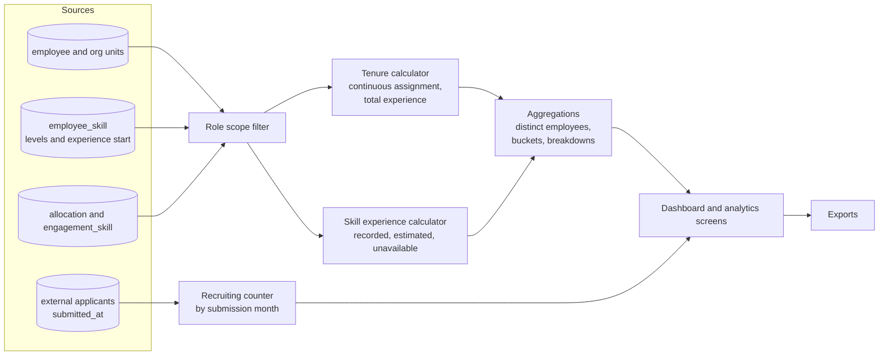

# 07 — Analytics Specification

All analytics run on the role-scoped set of **active internal employees**. External applicants have their own, separate statistics (7.3). Thresholds are parameters (`thresholdYears`), never constants. Defaults are 2 years for tenure and 3 years for skills.

## 7.1 Project tenure

| Metric                   | Definition                                                                                                                       |
| ------------------------ | -------------------------------------------------------------------------------------------------------------------------------- |
| Current project          | Active allocation today with the highest %, ties broken by the earliest start                                                    |
| Current tenure (days)    | today − start of the **continuous** assignment to that project (allocations on the same project joined when the gap is ≤ 7 days) |
| Above threshold          | current tenure / 365.25 **>** threshold (strictly "more than")                                                                   |
| Total project experience | Days on any project up to today, overlapping allocations counted once                                                            |
| Project count            | Distinct projects started on or before today                                                                                     |
| Distribution buckets     | < 1, 1–2, 2–3, 3–5, 5+ years, "No current project"                                                                               |
| Project breakdown        | Per current project: members, members above threshold, average and maximum tenure                                                |

Filters: business unit, current project, technology (person has the skill). Aggregates count each employee once (one current project per person).

**Data quality.** Tenure always comes from recorded `allocation.start_date`, so it is never estimated. An allocation without an end date counts as ongoing.

## 7.2 Skill experience

| Metric                      | Definition                                                                                                                                                            |
| --------------------------- | --------------------------------------------------------------------------------------------------------------------------------------------------------------------- |
| Experience start            | `experience_since` if recorded (RECORDED). Otherwise the earliest start of an allocation whose engagement skills include the skill (ESTIMATED). Otherwise UNAVAILABLE |
| Years                       | (today − start) / 365.25, one decimal                                                                                                                                 |
| Employees above threshold   | **Distinct** employees with ≥ 1 filtered skill whose years > threshold                                                                                                |
| Assignments above threshold | Employee–skill pairs above threshold                                                                                                                                  |
| Distribution buckets        | < 1, 1–3, 3–5, 5–10, 10+ years, "Start date unknown"                                                                                                                  |
| Competency distribution     | Count of employee–skill pairs per effective level 1–5                                                                                                                 |
| Per-skill breakdown         | Holders, above threshold, average years (known only), estimated count, unavailable count                                                                              |

Rules: the profile timestamp (`updated_at`, the date a skill was added) is **never** used as an experience start. UNAVAILABLE pairs are excluded from threshold counts and reported separately. ESTIMATED pairs are counted but flagged ("~").

## 7.3 Monthly applicant counting (recruiting)

- Month key = calendar month of `submitted_at` (creation/submission). Later edits never move an applicant.
- "This month" = the current calendar month up to today.
- Trend = last 12 months, including months with zero.
- Output: counts plus first/last name for list-authorised roles. Aggregate-only for management.

## 7.4 Allocation metrics

- Status on date (BENCH / PARTIAL / FULL) as defined in [06](06-search-and-ranking.md) §6.3.
- Dashboard "On bench" = BENCH today. The caption shows PARTIAL.
- Availability for demands is evaluated on the demand start date and looks ahead up to 92 days.

## 7.5 Dashboard metrics

| Widget                      | Source                                     | Drill-down          |
| --------------------------- | ------------------------------------------ | ------------------- |
| Internal employees          | scoped active employees (unit filter)      | Discovery           |
| On bench                    | status today                               | `status=BENCH`      |
| Same project > N y          | 7.1                                        | `tenureMin=N`       |
| Same skill > N y            | 7.2, distinct employees                    | `skillYearsMin=N`   |
| Applicants this month       | 7.3 (recruiting roles, management)         | External applicants |
| Demands with eligible staff | matching with default weights              | Demand matching     |
| Employees by business unit  | count per level-1 unit (whole scope)       | `bu=`               |
| Employees by technology     | people with the skill at level ≥ 3, top 10 | `skill=&level=3`    |
| Allocation status           | BENCH / PARTIAL / FULL                     | `status=`           |
| Competency distribution     | 7.2                                        | —                   |
| Current project tenure      | 7.1 distribution                           | Analytics           |

## 7.6 Diagram — workforce analytics data flow (10)

## 7.7 Aggregation rules

- Count people, not rows: every "number of employees" is a distinct count.
- Business-unit filter on the dashboard affects all widgets except "Employees by business unit", which always shows the whole scope as context.
- Rounding: years to one decimal for display. Threshold comparisons use unrounded values.

## 7.8 Data freshness

- Demo: computed on each request from the demo data, relative to today.
- Production: tenure, skills and status are computed from live tables (or the read model updated in the same transaction). Allocation-based figures are always as of the request date. Dashboards can be cached for up to 5 minutes. The "as of" date is shown on each screen.

## 7.9 Edge cases

| Case                                              | Handling                                                           |
| ------------------------------------------------- | ------------------------------------------------------------------ |
| Two active allocations with equal %               | Earliest start wins as current project                             |
| Allocation ends today                             | Still active today; next day not                                   |
| Re-assignment to the same project after > 7 days  | New continuous period (tenure restarts)                            |
| Skill added recently with an old recorded start   | Uses the recorded start (correct)                                  |
| Skill without a start and never used on a project | UNAVAILABLE, excluded from thresholds                              |
| Contract FTE < 1                                  | Capacity reduced accordingly (0.8 FTE, 50% allocated, so 30% free) |
| Inactive or new hire                              | Excluded (open question Q7 for new hires)                          |
| Threshold 0                                       | Anyone with any tenure or known years counts                       |
