# 08 — Cost and Usage Specification

> All prices and token counts in the demo are **illustrative**. No AI provider is called and nothing shown is an invoice or a quote.

## 8.1 Two meanings of "cost" (open question Q1)

| Dimension                    | Meaning                                                                                         | Status                                                                                                                                                                         |
| ---------------------------- | ----------------------------------------------------------------------------------------------- | ------------------------------------------------------------------------------------------------------------------------------------------------------------------------------ |
| A. Platform operating cost   | What it costs to run conventional and AI search (infrastructure, model tokens)                  | **Implemented** in the demo (Usage & costs page)                                                                                                                               |
| B. Workforce / business cost | Daily rates of the people found, staffing cost of a demand, cost differences between candidates | **Not implemented.** Internal rates are not in the system (only restricted `cost_code` bands, ADMIN/HR). Module 3 has external expected daily rates. Needs a business decision |

## 8.2 Which operations cost money

| Operation                                               | Incremental cost | Why                                                                             |
| ------------------------------------------------------- | ---------------- | ------------------------------------------------------------------------------- |
| Structured / Quick search, saved-search re-run, history | Negligible       | Indexed database queries on existing servers                                    |
| Dashboards, analytics, matching                         | Negligible       | Aggregations on small data volumes                                              |
| Exports                                                 | Negligible       | Generated in the browser (demo)                                                 |
| AI interpretation (LLM call)                            | **Per request**  | Input tokens (instructions + catalog + query) and output tokens (criteria JSON) |
| AI query answered by smart routing / fallback           | None             | No model call                                                                   |

## 8.3 Cost calculation

- Input tokens = `systemPromptTokens` (instructions + filter schema + catalog names; demo default 900) + ⌈query characters / 4⌉
- Output tokens = ⌈characters of the returned criteria JSON / 4⌉

AI cost per request:

$$\text{cost} = \frac{\text{in}\cdot P_{\text{in}} + \text{out}\cdot P_{\text{out}}}{10^6}$$

Conventional cost per request = `conventionalUsdPerThousand` / 1000 (demo: $0.002 per 1,000).

**Example (demo defaults: \$0.15 / 1M input, \$0.60 / 1M output).** Query of 110 characters gives 900 + 28 = 928 input tokens. Criteria of 480 characters give 120 output tokens. Cost = (928 · 0.15 + 120 · 0.60) / 10⁶ ≈ **\$0.00021**, about \$0.21 per 1,000 AI queries, versus \$0.002 per 1,000 conventional queries (about 100× cheaper).

Production uses provider-reported token counts instead of estimates.

## 8.4 Usage tracking

Each event: `user`, `kind` (`STRUCTURED`, `QUICK`, `AI_INTERPRETATION`, `AI_ROUTED`, `AI_FALLBACK`, `AI_SEARCH`, `MATCHING`), input/output tokens, cost, timestamp. The Usage & costs page shows the current month's:

- requests by kind
- tokens
- AI cost, conventional cost and total
- average cost per AI and per conventional query
- cost per 1,000 queries comparison
- requests per day (14 days)
- budget use
- the user's AI calls today

## 8.5 Limits and controls (implemented)

| Control                           | Behaviour                                                                 |
| --------------------------------- | ------------------------------------------------------------------------- |
| AI enabled switch                 | Off: every AI query uses keyword fallback (no cost), with a visible label |
| Smart routing                     | Queries made only of catalog terms skip the model                         |
| Daily limit per user (default 50) | Further AI queries fall back to keywords                                  |
| Monthly budget (default \$25)     | When AI spend reaches the budget, fallback for everyone                   |
| Saved AI searches                 | Re-run stored criteria without a model call                               |
| Pricing configuration             | ADMIN only. Read-only for PMO and MANAGEMENT                              |

## 8.6 Diagram — AI and conventional search cost flow (12)

```mermaid
flowchart TD
    Q["User request"] --> M{"Search mode"}
    M -->|"Structured or Quick"| C1["Database query"]
    C1 --> U1["Usage: conventional, negligible cost"]
    M -->|"AI Quick Search"| G{"AI enabled, under limit and budget?"}
    G -->|"No"| F["Keyword fallback"]
    F --> U2["Usage: AI_FALLBACK, cost 0"]
    G -->|"Yes"| R{"Only known catalog terms?"}
    R -->|"Yes, smart routing"| RT["Rule interpretation"]
    RT --> U3["Usage: AI_ROUTED, cost 0"]
    R -->|"No"| L["LLM call: query and catalog,<br/>no employee data"]
    L --> U4["Usage: tokens times price"]
    F --> S["Search with criteria"]
    RT --> S
    L --> S
    S --> U5["Usage: AI_SEARCH, conventional cost"]
    U1 --> DASH["Usage and cost dashboard, budget alerts"]
    U2 --> DASH
    U3 --> DASH
    U4 --> DASH
    U5 --> DASH
```

## 8.7 Production monitoring

- Persist events in `search_usage`. Also store provider request ids and reported tokens.
- Alert at 80% and 100% of the monthly budget (email/Teams to admins).
- Report cost per user, per business unit and per model. Compare against the conventional search share.
- Keep a model allow-list and versioned pricing (`ai_pricing_config.valid_from`), so historic costs stay correct after price changes.
- Optional: cache interpretations by normalised query text (24 h) to avoid repeat calls.

## 8.8 Assumptions and unresolved decisions

- The provider and model are not chosen (Azure OpenAI variables exist in deployment config but are unused).
- Data residency and DPA for sending catalog terms and queries to a provider must be confirmed. Queries may contain names typed by users, so a PII filter or masking is recommended.
- Budget owner and limits are to be agreed.
- Whether workforce cost (B) is in scope, and who may see rates (see [12](12-stakeholder-decisions.md)).
