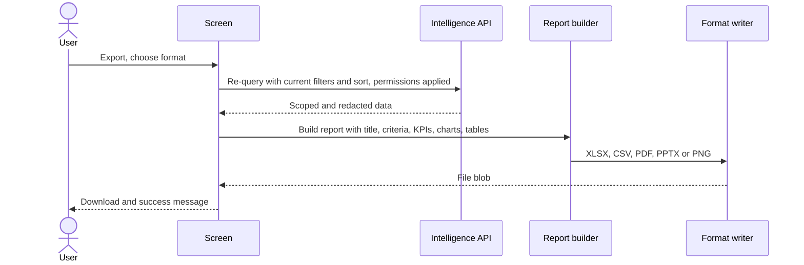

# 09 — Export and Reporting Specification

## 9.1 Supported formats (all implemented, no new dependencies)

| Format             | Writer                                               | Content                                                                                                                             | Limitations                                                                          |
| ------------------ | ---------------------------------------------------- | ----------------------------------------------------------------------------------------------------------------------------------- | ------------------------------------------------------------------------------------ |
| Excel `.xlsx`      | `lib/export/xlsx.ts` (Office Open XML + minimal ZIP) | "Summary" sheet (title, generated, criteria, KPIs, notes). One sheet per table and per chart's data. Bold header row, column widths | No native Excel charts (chart data is exported as sheets). Numbers stay numeric      |
| CSV `.csv`         | `lib/export/csv.ts`                                  | UTF-8 with BOM. Title, criteria and notes lines, then each table and each chart's data                                              | Formula-like cells are prefixed with `'` (CSV injection protection)                  |
| PDF `.pdf`         | `lib/export/pdf.ts` (PDF 1.4)                        | A4 landscape. Title, criteria, KPIs, charts as images, paginated tables with repeated headers, page footer                          | Standard fonts, so non-basic-Latin letters are transliterated (ć→c, đ→dj, € → EUR)   |
| PowerPoint `.pptx` | `lib/export/pptx.ts` (PresentationML)                | Title slide (criteria, KPIs), one slide per chart (image), table slides of 12 rows                                                  | Up to 7 columns per table slide (note added). Charts are images, not editable charts |
| Image `.png`       | `lib/export/image.ts` (canvas)                       | Title, criteria, KPIs, all charts as bars, first table (30 rows)                                                                    | Snapshot only. A note points to Excel/CSV for full data                              |

Every chart is exported as a labelled horizontal bar chart, so values stay readable in every format.

## 9.2 Report types

| Screen                       | Report                                                         | Tables                                                               | Charts                           |
| ---------------------------- | -------------------------------------------------------------- | -------------------------------------------------------------------- | -------------------------------- |
| Discovery                    | Workforce search results (active filters and sort, ≤ 500 rows) | Results (seniority and cost code only for ADMIN/HR)                  | —                                |
| Saved / recent search        | Run it, then export from Discovery (same report)               | —                                                                    | —                                |
| Dashboard                    | Workforce dashboard                                            | Demand matching overview (matching roles)                            | 5–6 charts                       |
| Experience analytics, tenure | Project tenure analytics                                       | By project, by employee (if individuals visible)                     | Distribution                     |
| Experience analytics, skills | Skill experience analytics                                     | By skill, by employee and skill                                      | Distribution, competency         |
| Demand matching              | Demand matching report                                         | Eligible (rank, score, components), near misses (missing must-haves) | Score of eligible                |
| External applicants          | External applicants                                            | Monthly counts, names (first and last only)                          | Monthly trend                    |
| Usage & costs                | Search usage and cost (illustrative)                           | Usage by type                                                        | Requests by type, cost per 1,000 |

## 9.3 Rules

- **Filters and sorting:** reports are built when the user clicks Export, from the current screen state. Discovery re-queries the API with the same filters and sort.
- **Permissions:** exports use the same API responses as the screen, so row scope and field redaction apply automatically. Management exports contain aggregates only.
- **Metadata:** title, subtitle, generation timestamp and username, criteria list, notes (scope, data quality, illustrative pricing).
- **Personal data:** no contact details, CVs or applicant fields beyond names. Employee exports never include restricted fields for unauthorised roles.
- **File names:** `<report>-<yyyy-mm-dd>.<ext>`, ASCII-safe.

## 9.4 Diagram — export and reporting workflow (11)

## 9.5 Production notes

- Large exports (> 5,000 rows) should move to the backend (Apache POI is already a dependency) as asynchronous jobs.
- Log every export (user, report, row count, format) in `audit_log` with action `EXPORT`, which already exists in the enum.
- Optional: company template (logo, colours) for PDF/PPTX.
