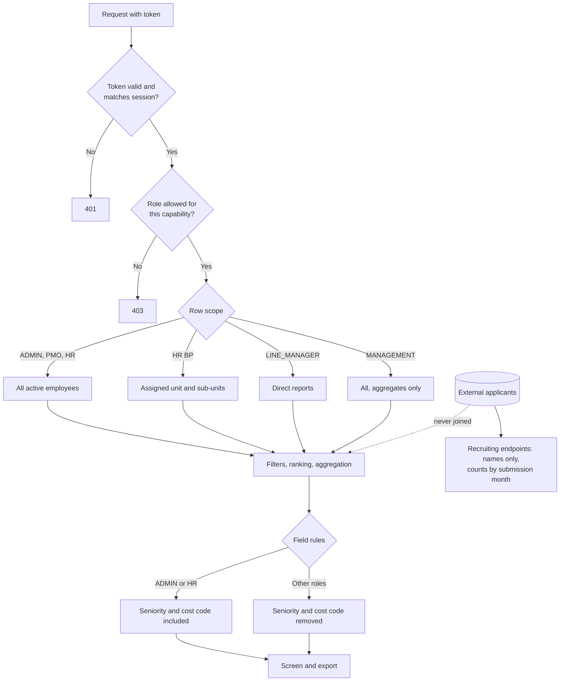

# 10 — Security and Permissions

## 10.1 Role matrix (implemented in the demo API)

| Capability                           | ADMIN    | PMO      | HR       | HR BP            | LINE_MANAGER   | MANAGEMENT      | EMPLOYEE |
| ------------------------------------ | -------- | -------- | -------- | ---------------- | -------------- | --------------- | -------- |
| People search (Discovery)            | All      | All      | All      | Own unit subtree | Direct reports | —               | —        |
| See seniority / cost code            | ✓        | —        | ✓        | —                | —              | —               | —        |
| Dashboard / analytics                | ✓        | ✓        | ✓        | Unit             | Team           | Aggregates only | —        |
| Individual rows in analytics         | ✓        | ✓        | ✓        | ✓                | ✓              | —               | —        |
| Demand matching                      | ✓        | ✓        | —        | Unit             | —              | —               | —        |
| External applicants list (names)     | ✓        | ✓        | —        | ✓                | —              | —               | —        |
| Applicant monthly counts             | ✓        | ✓        | —        | ✓                | —              | ✓               | —        |
| Usage & costs (view)                 | ✓        | ✓        | —        | —                | —              | ✓               | —        |
| Edit AI pricing, limits, reset usage | ✓        | —        | —        | —                | —              | —               | —        |
| Saved searches and history           | Own only | Own only | Own only | Own only         | Own only       | —               | —        |

Row rules match the existing backend (`ScopeService`, `DemandAccessPolicy`). Demo identities: the line manager acts as Bojan Ilić and the HR BP covers _Software Factory_.

## 10.2 Enforcement order

1. Authentication: the bearer token must match the signed-in session (demo) or a valid JWT (production).
2. Role capability check per endpoint (403 otherwise). The UI also hides routes, but the API check is authoritative.
3. Row scope applied **before** filtering, ranking, aggregation and export.
4. Field-level redaction (seniority, cost code; applicant fields beyond names).
5. Response, which is the same data used for screens and exports.

## 10.3 Diagram — permission-aware visibility (9)

## 10.4 External applicant restrictions

- Separate data classification and endpoints (`/applicants`, `/applicants/trend`). They are never in search, analytics, matching or employee exports.
- The API projects `{id, firstName, lastName}` only. Email, phone and CV fields exist in demo data only to prove they are never returned.
- Monthly counting uses the submission date.

## 10.5 AI and data leakage

- No employee data is sent to an AI model. The model receives only the query text and catalog terms.
- AI output is validated by the same sanitiser as user input. Unknown ids are dropped and ranges clamped.
- The UI labels the simulation. Production must label real AI output as "AI-interpreted criteria — review before use".
- Search history stores criteria and labels only, never result rows. Users can clear their history.

## 10.6 Input validation (implemented)

All endpoints sanitise their bodies:

- known ids only
- numeric ranges clamped
- string lengths limited (query 500, names 80)
- lists capped (10 skills, 15 criteria)
- page size ≤ 500

CSV export prevents formula injection. XML writers escape all text and strip control characters.

## 10.7 What production still needs

- Real backend endpoints with `@PreAuthorize` per capability, plus the row-scope predicates inside SQL (not in memory).
- The existing defect where deactivated users can still use valid JWTs (noted in `m3-implementation-plan.md`) must be fixed before exposing broad search.
- HR BP and line-manager identities resolved from the real user record (demo uses fixed stand-ins).
- Audit log entries for searches with exports, AI interpretations and pricing changes.
- Data retention:
  - search history: 90 days
  - usage: 13 months
  - applicant data: recruiting retention policy
- A DPA and data residency decision for the LLM provider, and PII masking of free-text queries.
- Rate limiting on the interpret endpoint.
- Remove demo seed passwords in non-dev environments (existing known issue).
