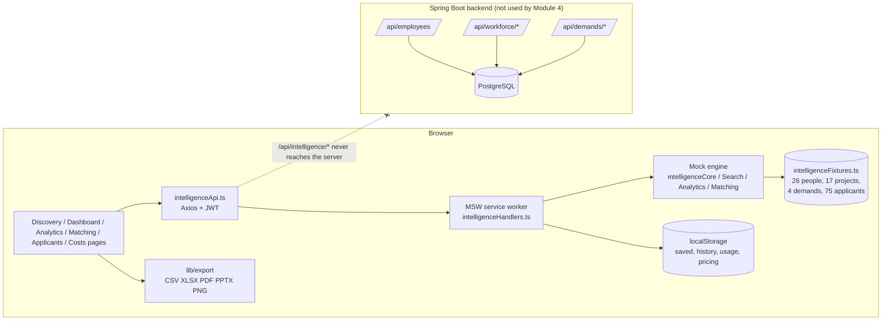
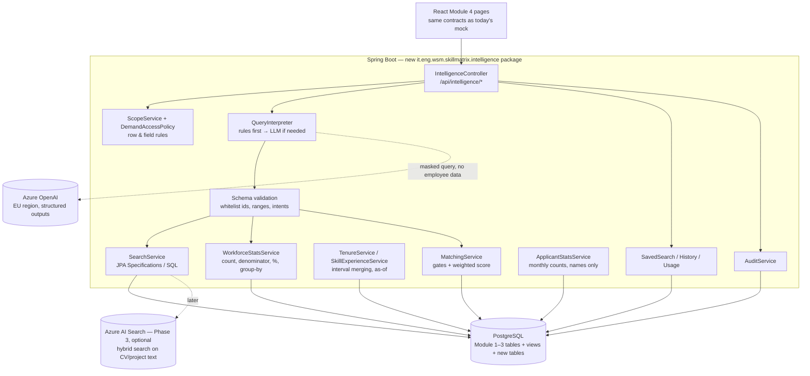

# 13 — Search & Discovery Audit: Requirements Validation

| | |
|---|---|
| **Audit date** | 4 November 2026 |
| **Branch / commit** | `main` @ `e2a8718` |
| **Scope** | Search & Discovery (Module 4 "Workforce Intelligence"), plus the Module 1–3 data it depends on |
| **Audience** | Product owners, business stakeholders, developers |
| **Method** | Full code read of frontend, mock API and backend. The search/analytics/matching engine was **executed** against its demo data with a fixed date of 2026-11-04 (temporary test harness, removed afterwards). The existing unit tests were run (12/12 pass). The UI was **not** clicked through in a browser. |

> **Data warning.** Every number in this report comes from the **demo fixture** in `frontend/src/mocks/intelligenceFixtures.ts` (26 fictional people, 17 projects, 4 demands, 75 applicants). None of it is company data. Numbers are quoted only to show how the logic behaves.

---

## 1. Executive summary

### Overall status

**The Search & Discovery feature is a clickable prototype, not a working product.** All six screens exist and behave convincingly, but:

1. **There is no backend.** Every `/api/intelligence/*` call is answered inside the browser by a mock service worker (MSW). The Java backend has no search, analytics, matching, saved-search or applicant-statistics endpoint. Evidence: `frontend/src/features/search/mockMode.ts` ("Module 4 has no backend yet"), `docs/workforce-intelligence/00-implementation-report.md` §5–6, and no matching code under `backend/src/main/java`.
2. **The data is fake.** Results come from a fixed fixture, not from the Module 1–3 database. The mock is **switched on in every build, including the production container**, unless `VITE_USE_SEARCH_MOCKS=false` is set.
3. **There is no AI.** "AI Quick Search" is a regex/keyword rule engine (`parseQuery` in `frontend/src/mocks/intelligenceSearch.ts`). No LLM is called. `azure.openai.endpoint/key` exist in `backend/src/main/resources/application.yml` but no Java code reads them and `pom.xml` has no AI SDK.
4. **Persistence is per browser.** Saved searches, history, usage and AI pricing live in `localStorage`. They are not shared between users or devices.

The prototype is still valuable: its rules (tenure merging, scope-before-aggregation, must-have gates, names-only applicants) are a good executable specification. But it cannot be presented as a complete solution.

### Most important gaps

| # | Gap | Why it matters |
|---|---|---|
| 1 | No backend or real data for any Module 4 screen | Nothing the screens show is true for the company |
| 2 | **No percentages anywhere** (no share, ratio or denominator in any API or screen) | The headline question "How many Java developers do we have, percentage-wise?" cannot be answered |
| 3 | **No "Java developer" definition.** The engine uses "Java skill at level ≥ 3" and also counts B2B and supplier contractors | On demo data, four reasonable definitions give 4, 6, 9 or 11 people (17%–46%) |
| 4 | AI Quick Search fails on question-style queries. "**How many** employees have been on the same project for more than 2 years?" returns **0** (correct answer on demo data: 8) | The words "how many" become a mandatory free-text filter |
| 5 | **Serbian queries are not supported.** Both stakeholder questions in Serbian return 0 results | Stakeholders asked in Serbian |
| 6 | Demand matching runs on 4 fixture demands, not on real Module 3 demands, and edits are not saved | Must-have/optional scoring is not usable in the staffing process |
| 7 | Real backend `GET /api/employees` **ignores** `skillId`, `skillLevelMin`, `validationStatus` (TODO left in code) | A skill filter silently returns everyone. This is a live bug outside the prototype |

### Biggest technical risks

- **Data model mismatch.** The prototype assumes an "experience since" date per skill, employee languages, project industry and applicant submission dates. The real schema stores a static `years_of_experience` number, has no languages, puts industry on the client (`verticalN1/N2`), and stores external people as a single `fullName` with no application date.
- **Client-side authorisation.** Scope rules run in the browser against data already shipped to the browser. The fixture bundle includes applicant e-mails, phones and CV file names. These are fake, but the pattern must not reach production.
- **Mock enabled in production builds.** Users can mistake demo figures for real ones. A "Demo data" chip exists only on Discovery.

### Biggest business risks

- Workforce percentages presented without an agreed denominator or "Java developer" definition will be disputed. Different definitions give answers between 17% and 46% on the same data.
- "Same skill > 3 years" counts **21 of 24** demo people (88%). Any skill qualifies, start dates are self-declared, and the end of use is ignored. As a KPI it says almost nothing.
- Stakeholders may believe AI search exists because the UI says "AI Quick Search", even though it is labelled "Simulated AI".

---

## 2. Existing architecture

### 2.1 Frontend

- React 18 + TypeScript + Vite, MUI, React Query, Zustand (`authStore`), Axios with JWT (`frontend/src/api/axiosClient.ts`).
- Module 4 routes (`frontend/src/router/AppRouter.tsx:201-210`): `/search`, `/intelligence/dashboard`, `/intelligence/analytics`, `/intelligence/matching`, `/intelligence/applicants`, `/intelligence/costs`. They are guarded by `ProtectedRoute` with `getModuleRoles('intelligence')`.
- Main pieces: `pages/SearchDiscovery/index.tsx` (3 search modes, saved searches, history, export), `features/intelligence/*` (API hooks, criteria form, result table, saved-search drawers), `pages/Intelligence/*` (dashboard, analytics, matching, applicants, costs), `lib/export/*` (CSV, XLSX, PDF, PPTX, PNG generated in the browser).

### 2.2 Backend

- Spring Boot (Java), PostgreSQL, Liquibase (`db/changelog/001…031`), JWT security (`config/SecurityConfig.java`, `security/*`), audit log (`AuditService`).
- Packages: Module 1 skill matrix (`entity`, `service`, `controller`), Module 2 workforce (`workforce/*`: allocations, projects, structure, bench, availability), Module 3 demand (`demand/*`: demands, candidates, external persons).
- **No Module 4 package.** The only search-like backend features are:
  - `GET /api/employees` with name/e-mail `LIKE`, manager, org node, location, status and workforce-type filters (skill filters ignored, see §1).
  - `GET /api/workforce/availability`, `/bench`, `/summary`: real bench and availability by date.
  - `GET /api/demands/{id}/candidate-options`: internal people ranked **only by availability**, plus known external people.

### 2.3 Database (relevant real entities)

| Entity | Fields relevant to Search & Discovery | Gaps vs requirements |
|---|---|---|
| `Employee` | `jobTitle`, `jobProfile`, `location`, `manager`, `employmentStatus` (ACTIVE, INACTIVE, NEW_HIRE, PENDING_VALIDATION), `workforceType` (EMPLOYEE, B2B, SUPPLIER), `contractFte` | No hire date, no languages, no "primary technology" |
| `EmployeeSkill` | `selfAssessedLevel`, `managerValidatedLevel`, `validationStatus`, **`yearsOfExperience` (static number)**, **`lastUsedDate`** | No "experience since" date. The years number goes stale the day after it is entered |
| `EmployeeSkillHistory` | Versioned snapshot of the above | Could anchor `yearsOfExperience` to the date it was entered |
| `Allocation` | `employee`, `project`, `roleName`, `allocationPct`, `startDate`, `endDate`, `expectedEndDate` | Good basis for tenure and availability |
| `AllocationHistory` | JSON before/after per change | Usable for audit; makes history reconstruction harder |
| `EngagementSkill` | Skill used on an allocation, `levelUsed`, `primarySkill` | Good basis for project-derived skill experience |
| `EmployeeHorizontalAssignment` / `HorizontalNode` | Dated org-unit (business unit / team) membership | Good basis for BU filters and history |
| `EmployeeVerticalAssignment`, `Client.verticalN1/N2` | Market/industry | Project has no industry of its own |
| `Certificate` | `expirationDate`, linked skills | OK |
| `Demand` / `DemandSkill` | `DemandSkill.mustHave`, `optional`, `requiredLevel` | No weights, no minimum years, no non-skill criteria |
| `ExternalPerson` / `Candidate` (type EXTERNAL) | `fullName`, `email`, `createdAt`; candidacy per demand | Separate table (good). **No first/last name split, no application date** |
| `AuditLog` | Generic entity audit | Searches, AI calls and exports are not audited |

### 2.4 Search and AI implementation (prototype)

**Request flow, verified in code:** user action → page component → React Query hook (`features/intelligence/intelligenceApi.ts`) → Axios `POST {API_BASE_URL}/api/intelligence/search` → intercepted by MSW (`mocks/intelligenceHandlers.ts:160`) → `authorize()` reads the role from the **browser's** auth store → `searchPeople()` filters fixture profiles → JSON → `ResultsTable`.

**AI Quick Search flow:** text → `POST /api/intelligence/interpret` → `parseQuery()` (regex phrases for skills, countries, units, industries, projects, tenure, "same skill", dates, bench, seniority; Levenshtein typo fixing; leftover words become a **mandatory free-text filter**) → token and cost **estimate** (characters ÷ 4) written to `localStorage` → filters shown as chips and an editable form → `POST /search`.

### 2.5 Microsoft / Azure

- `application.yml` has `azure.openai.endpoint` and `azure.openai.key` placeholders. They are **unused**.
- No Azure AI Search, Azure AI Foundry, Entra ID, Graph or Power BI integration exists. Authentication is local JWT with username and password.
- The documented target (`docs/workforce-intelligence/04-technical-architecture.md`) is compatible with Azure OpenAI, but nothing is built.

---

## 3. Requirements traceability matrix

Status key: **COMPLETE** = verified end-to-end on real data. **PARTIALLY IMPLEMENTED** = the logic exists in the prototype or the real backend, but not both, or with gaps. **MISSING**, **BROKEN**, **UNKNOWN**.
No item is COMPLETE, because no Module 4 feature runs on real data.

### 3.1 Workforce analytics (special attention)

| ID | Requirement | Existing implementation | Status | Evidence | Missing work | Priority |
|---|---|---|---|---|---|---|
| WA-01 | Count Java developers | Dashboard chart "Employees by technology (level 3+)"; Quick search "Java developers" | PARTIALLY | `intelligenceAnalytics.ts:439-448`; demo gives 9 | Agreed definition; real data; backend | P0 |
| WA-02 | Percentage of Java developers | None | **MISSING** | No `%`, share or ratio in any response type (`intelligence.types.ts`) or page | Count + denominator + % in the API and UI | P0 |
| WA-03 | Explain the denominator | Only "Active staff in scope" caption on the KPI | MISSING | `Dashboard/index.tsx:88` | Population definition shown with every figure | P0 |
| WA-04 | Exclude external applicants from workforce stats | Applicants are a separate fixture, never in profiles | PARTIALLY (prototype) | Probe: 0 applicants in search; `allProfiles()` reads `INTEL_EMPLOYEES` only | Same guarantee in backend queries | P0 |
| WA-05 | Decide on contractors (B2B, SUPPLIER) in the denominator | Included silently (4 of 24 demo "internal employees") | **BROKEN** (undefined rule) | `intelligenceCore.ts:380` filters only on `employmentStatus === 'ACTIVE'` | Business rule + `workforceType` filter | P0 |
| WA-06 | No double-counting | Counts are per person (`Set` of employee ids) | PARTIALLY | `intelligenceAnalytics.ts:277`. One skill id per person, so Java variants cannot double-count. A "Java family" grouping does not exist | Skill grouping/taxonomy | P1 |
| WA-07 | Distinguish knows / primary / professional / recent Java | Not distinguished | MISSING | Engine has level + evidence only; real `lastUsedDate` and `EngagementSkill.primarySkill` unused | Four definitions as selectable "population lenses" | P0 |
| WA-08 | Filter population by BU, department, role, status | BU only (dashboard, analytics) | PARTIALLY | `dashboard()`/`tenureAnalytics()` take `businessUnitId` | Team, role/job profile, workforce type, status, country | P1 |
| WA-09 | Same for other technologies and roles | Technology chart (top 10 only); no role distribution | PARTIALLY | `.slice(0, 10)` drops e.g. .NET from the chart | Full distribution, role distribution | P1 |
| WA-10 | Compare Java vs .NET | Not possible: AI query requires both skills (ALL) → 0 results | **BROKEN** | Probe: "Compare the number of Java and .NET developers" → 0 | Comparison analytics endpoint and view | P1 |
| WA-11 | Same project > 2 years: count | Analytics tab, dashboard KPI, Quick search | PARTIALLY | Demo: 8 people | Real backend; % of population | P0 |
| WA-12 | Same project > 2 years: list with project and start date | Yes (name, project, client, since, years) | PARTIALLY | `TenureEmployeeRow` | Real data | P0 |
| WA-13 | Continuous vs accumulated time on same project | Continuous only (gaps ≤ 7 days merged). Accumulated per project is not computed | PARTIALLY | `currentAssignment()` `intelligenceCore.ts:318-353` | Accumulated tenure metric | P1 |
| WA-14 | Tenure on **any** concurrent project | Only the "main" project (highest %) is measured | **BROKEN** for multi-project staff | `intelligenceCore.ts:325-327` | Evaluate every active assignment | P1 |
| WA-15 | Same skill > 3 years: count and list | Analytics tab, KPI, Quick search; counted once per person | PARTIALLY | Demo: 21 of 24; 17 skill records with unknown dates | Real data; agreed definition | P0 |
| WA-16 | Declared vs project-derived skill experience | Labelled RECORDED / ESTIMATED / UNAVAILABLE | PARTIALLY | `intelligenceCore.ts:404-412` | ESTIMATED = first project start → today; gaps not removed, so it overstates | P1 |
| WA-17 | Experience ranges 1–3, 3–5, 5+ | Distribution chart buckets <1, 1–3, 3–5, 5–10, 10+ | PARTIALLY | `bucketize()` | Not filterable; bucket edges ambiguous (3.0 → "3–5") | P2 |
| WA-18 | Total professional experience vs technology experience | Not available | MISSING | No hire date / career start in `Employee` | Data field + import | P2 |
| WA-19 | Availability statistics | Bench / partial / full today | PARTIALLY | Dashboard donut; real `/api/workforce/summary` exists separately | Use real backend | P1 |
| WA-20 | Historical trends | Applicants per month only | MISSING | — | Snapshots or point-in-time queries | P3 |

### 3.2 Search

| ID | Requirement | Existing implementation | Status | Evidence | Missing work | Priority |
|---|---|---|---|---|---|---|
| S-01 | Centralised search across employees, skills, projects, roles, BUs, allocations | One people search with all those filters (prototype) | PARTIALLY | `searchPeople()` | Real backend | P0 |
| S-02 | Exact keyword search | Free text (all tokens, 1-typo tolerance) over name, title, unit, projects, skills | PARTIALLY | `textMatches()`; real `/api/employees?search=` only covers name/e-mail | Real backend | P1 |
| S-03 | Structured filtering | Full criteria form | PARTIALLY | `CriteriaForm.tsx` | Real backend | P0 |
| S-04 | AND / OR across skills | ALL / ANY switch | PARTIALLY | `skillMatch` | NOT, mixed groups | P2 |
| S-05 | Semantic / vector search | None | MISSING | Documented as Phase 3 | See §10 | P3 |
| S-06 | Natural-language search | Rule engine | PARTIALLY | `parseQuery()` | Real LLM interpretation | P1 |
| S-07 | Sorting, paging | Relevance, name, availability, tenure, experience | PARTIALLY | `SearchResultRow` sort | Real backend | P1 |
| S-08 | Real employee skill filter (`/api/employees`) | Parameters accepted and ignored | **BROKEN** | `EmployeeService.java:322-324` TODO | Implement predicates | P0 |

### 3.3 AI Quick Search

| ID | Requirement | Status | Evidence / note |
|---|---|---|---|
| AI-01 | Real LLM interpretation | **MISSING** | Engine label "Simulated AI (demo rule engine, no LLM connected)" |
| AI-02 | Search without configuring filters | PARTIALLY | Works for catalog phrasing (skills, units, countries) |
| AI-03 | Example queries | PARTIALLY | 5 chips, all phrased to work (`SearchDiscovery/index.tsx:66-72`) |
| AI-04 | Show interpretation | PARTIALLY | "Interpreted criteria" chips + notes |
| AI-05 | Edit extracted criteria | PARTIALLY | Full `CriteriaForm` under the interpretation |
| AI-06 | Conversational refinement | **MISSING** | Every query starts from empty filters |
| AI-07 | Save AI searches with structured criteria | PARTIALLY | Saved with `filters` + `query` (`intelligenceStore.ts:62-76`) |
| AI-08 | Why results match | PARTIALLY | `reasons[]` per row when skills are in the query |
| AI-09 | Ambiguous / unsupported requests | **BROKEN** | Unknown words become a mandatory text filter → silent 0 results |
| AI-10 | Answer count / percentage questions | **MISSING** | Search returns lists only; "how many" breaks the query |
| AI-11 | Serbian | **MISSING** | Both Serbian stakeholder questions → 0 results |
| AI-12 | Graceful failure / fallback | PARTIALLY | Fallback when AI is off, over limit or over budget (simulated) |
| AI-13 | Prompt-injection protection, output validation | PARTIALLY (concept) | `sanitizeFilters()` whitelists ids and ranges. This is the right pattern for a real LLM |
| AI-14 | Token/cost monitoring | PARTIALLY | Estimates only; `localStorage`; UTC vs local-date mismatch in `aiRequestsToday()` |

### 3.4 Demand matching

| ID | Requirement | Status | Evidence / note |
|---|---|---|---|
| DM-01 | Multiple must-have and optional criteria | PARTIALLY | Up to 15 each; types SKILL, CERTIFICATION, INDUSTRY, PROJECT_EXPERIENCE, LANGUAGE |
| DM-02 | Per-criterion weights | PARTIALLY | Optional weight 1–5; component weights 0–100 |
| DM-03 | Must-have failure disqualifies | PARTIALLY | Not eligible, no score (`intelligenceMatching.ts:333, 399`) |
| DM-04 | Deterministic score | PARTIALLY | Verified: two runs per demand gave identical output |
| DM-05 | Transparent explanation | PARTIALLY | Per-criterion met/credit/detail + formula line |
| DM-06 | Availability, allocation, experience considered | PARTIALLY | HARD (gate) or RANKING (score) availability mode |
| DM-07 | Same person against several demands | PARTIALLY | Each demand separately; no cross-demand view |
| DM-08 | Edit criteria and recalculate | PARTIALLY | Recalculates; **edits are not saved** to the demand |
| DM-09 | Runs on real Module 3 demands | **MISSING** | Uses `INTEL_DEMANDS` fixtures. Real `DemandSkill.mustHave/optional` is not connected. Real `candidate-options` ranks by availability only |
| DM-10 | Candidate comparison side by side | **MISSING** | Card list only |
| DM-11 | Score snapshot / decision record | MISSING | Open question Q9 in doc 12 |
| DM-12 | LLM must not score | COMPLETE by design (prototype) | No LLM involved; formula is code |

### 3.5 External applicants

| ID | Requirement | Status | Evidence / note |
|---|---|---|---|
| EA-01 | Not in internal search | PARTIALLY | Separate fixture and separate real table (`external_person`) |
| EA-02 | Not in workforce stats | PARTIALLY | Same as above |
| EA-03 | First + last name only | PARTIALLY (prototype) / **BROKEN** (real) | Mock returns `{id, firstName, lastName}`. Real data has only `fullName`, and `candidate-options` also returns **e-mail** |
| EA-04 | Monthly count by a defined date | PARTIALLY (prototype) | "Submission date" in the mock. The real model has no submission date (only `ExternalPerson.createdAt` / `Candidate.createdAt`) |
| EA-05 | Permission-restricted | PARTIALLY | LIST: Admin, PMO, HR BP. AGGREGATE: Management. NONE: HR, line manager. Client-side only |
| EA-06 | No leak through AI or exports | PARTIALLY | AI parser adds a note for "applicant"; exports built from the same API |

### 3.6 Saved searches, reporting, security, infrastructure

| ID | Requirement | Status | Evidence / note |
|---|---|---|---|
| SS-01 | Save, name, reopen, edit, delete, re-run on current data | PARTIALLY | All present (`SearchLibrary.tsx`, `intelligenceStore.ts`); `localStorage` only |
| SS-02 | Recent searches separate from saved | PARTIALLY | History drawer, 25 entries, de-duplicated |
| SS-03 | Share saved searches | **MISSING** | Per user and per browser |
| SS-04 | Structured criteria stored (not just text) | PARTIALLY | Yes: `filters` + `sort` + `query` |
| RE-01 | Excel / PDF / PowerPoint / PNG / CSV | PARTIALLY | Generated in the browser (`lib/export/*`); PDF transliterates Serbian letters; PPTX ≤ 7 columns; PNG first table, 30 rows |
| RE-02 | Criteria, totals and timestamp in exports | PARTIALLY | `Report.criteria`, `kpis`, `generatedAt`, `generatedBy` |
| RE-03 | Workforce statistics exports with percentages | MISSING | No percentages exist |
| RE-04 | Export permissions and audit | MISSING | Anyone who can see a page can export; nothing logged |
| SEC-01 | Server-side role and row scope for Module 4 | **MISSING** | `authorize()` runs in the browser (`intelligenceHandlers.ts:73-99`) |
| SEC-02 | Field-level hiding (seniority, cost code) | PARTIALLY | Prototype mirrors `EmployeeService` rules |
| SEC-03 | Audit of searches, AI calls, exports | MISSING | — |
| SEC-04 | AI data-processing controls (PII, region, DPA) | MISSING | Open question Q5 |
| INF-01 | LLM provider and model | MISSING | None |
| INF-02 | Azure OpenAI / AI Foundry / AI Search | MISSING | Config placeholders only |
| INF-03 | Caching, logging, monitoring of search | MISSING | — |
| INF-04 | Retention of history and usage | MISSING | Open question Q11 |

---

## 4. Critical workforce analytics audit

### 4.1 "How many Java developers do we have, percentage-wise?"

**Can the application answer it today? No.** It can show a count (9 on demo data) in a dashboard chart. It cannot show a percentage, a denominator or a definition choice, and the natural-language form of the question returns 0 results.

**What counts as a Java developer today:** `EmployeeSkill(Java).level ≥ 3` (validated level if validated, otherwise self-assessed), among `ACTIVE` people of **any** workforce type. Job title, primary project technology, recency and contractor status are ignored.

**Same demo data, different definitions** (denominator = 24 active people in the mock):

| Definition | Count | % of 24 | Note |
|---|---|---|---|
| Has Java at any level | 11 | 45.8% | "Knows Java" |
| Java level ≥ 3 (current engine) | 9 | 37.5% | Includes 1 B2B contractor |
| Java is the primary skill on a current allocation | 6 | 25.0% | "Works as a Java developer now" |
| "Java" in job title | 4 | 16.7% | Misses e.g. "Backend Developer" |
| Java level ≥ 3, EMPLOYEE workforce type only (denominator 20) | 8 | 40.0% | Contractors removed from numerator and denominator |

**Can the real data model support a reliable answer? Yes, once definitions are agreed.**
- Skill level and validation: `EmployeeSkill`.
- Recency: `EmployeeSkill.lastUsedDate` (exists, unused).
- Primary technology now: `Allocation` + `EngagementSkill.primarySkill`.
- Role: `Employee.jobTitle` / `jobProfile` (free text, needs normalising).
- Population: `employmentStatus`, `workforceType`, org unit from `EmployeeHorizontalAssignment`.

**Recommendation:** offer named "lenses" (Knows / Professional / Primary now / Recently used) with one stakeholder-approved default. Always return `{count, denominator, percentage, populationDefinition, asOf}`.

### 4.2 Same project for more than 2 years

| Aspect | Today (prototype) | Assessment |
|---|---|---|
| Calculation | Days since the start of the continuous assignment to the **main** current project (highest %). Back-to-back allocations with gaps ≤ 7 days are merged. Strict "> 2.0 years" | Sound rule, but... |
| Multiple concurrent projects | Only the main project counts | Someone 3 years at 40% on project A, now 60% on B, is **missed** |
| Accumulated time | Not computed per project (only total across all projects) | Needs a definition |
| Output | Count (8), list with project, client, start date, years; per-project table; distribution | No % (8/24 = 33% on demo data is not shown) |
| Filters | BU, current project, technology | No team, client or date ("as of") |
| Real data | `Allocation.startDate/endDate` per project supports this fully | Need "as of" date and an allocation-history check (edits may overwrite start dates; `AllocationHistory` holds JSON diffs) |

### 4.3 Same skill for more than 3 years

| Aspect | Today (prototype) | Assessment |
|---|---|---|
| Source of years | 1) recorded "since" date → today; 2) else first project using the skill → today (ESTIMATED); 3) else unknown | (1) ignores when the skill was last used; (2) counts gaps between projects as experience |
| Real data | Static `yearsOfExperience` number + `lastUsedDate`. **No start date** | A number typed in 2024 is wrong in 2026 unless anchored to `EmployeeSkillHistory.changedAt` |
| Overlaps | Not double-counted (span, not sum). But the span also counts gaps | Use merged intervals of allocations with that `EngagementSkill` |
| Missing dates | Shown as "unknown" and excluded from "above threshold" | Good. Shown as a data-quality KPI |
| Result on demo | 21 of 24 people (57 skill records) above 3 years; 17 records unknown | "Any skill > 3 years" is close to everyone. Needs a specific skill or "current skill" scope to be meaningful |
| Ranges | Chart buckets only | Not filterable |

### 4.4 Technology and department distribution

- Technology chart is **top 10 only**, level ≥ 3, no percentages, no "other" bucket.
- Business unit chart counts people; it ignores the BU filter by design.
- No role distribution, no department × technology matrix, no comparison view.

### 4.5 Data quality and history limits (real data)

- Experience years are self-entered, static, and optional.
- No career start / hire date, so "total professional experience" is impossible.
- Org-unit, vertical and allocation tables are dated. Point-in-time ("as of") analytics are feasible.
- Skill names are free catalogue entries with no grouping (e.g. "Java", "Java EE", "Spring" are unrelated).
- `jobTitle` is free text.

---

## 5. Demand matching audit

### 5.1 Formula (prototype, `intelligenceMatching.ts`)

1. **Eligibility:** every must-have criterion must be met. In HARD availability mode, "free ≥ required % on the start date" is an extra must-have. Ineligible people get **no score**. Only "near misses" (at least one must-have met) are listed.
2. **Components** (each 0–100):
   - *Optional* = Σ(weight × credit) / Σ weight. Credit is 1/0, or for skills `min(1, level/minLevel)` × (1 if years OK, else 0.5).
   - *Competency* = average level fit over **all** skill criteria (must-have + optional). Unverified skills count ×0.75. Bonus +0.1 per level above the minimum, capped at 1.
   - *Experience* = share of skill/industry/project criteria evidenced by project history.
   - *Availability* = 100 if free on the start date; 80/60/35 if free within 15/30/92 days; otherwise proportional, max 50.
3. **Score** = weighted average of the applicable components. Defaults: optional 40, competency 25, experience 15, availability 20. Weights of components that do not apply are redistributed.
4. **Ranking:** score, then free % on the start date, then name.

### 5.2 Verified behaviour (demo data)

- DEM-M01: 2 eligible (100, 60). 12 near misses, mostly failing the availability gate.
- DEM-M03: 1 eligible (100). Marko is a near miss (no CKA certificate, not available).
- DEM-M02 (RANKING mode): Ivana is eligible with availability 0 and score 30. This is correct for ranking mode, but users may not expect it.
- Deterministic: identical output on repeated runs.

### 5.3 Findings

| # | Finding | Severity |
|---|---|---|
| 1 | Not connected to real demands. Real `DemandSkill` already has `mustHave`, `optional` and `requiredLevel`, but no weight or minimum years | High |
| 2 | Edits are not saved. Matching results are not stored (no decision record) | High |
| 3 | Must-have skills count twice: as a gate and again in the competency component | Medium. Document or exclude |
| 4 | "Match N percent" label in the UI. The score is a weighted fit, not a probability | Low. Rename to "fit score" |
| 5 | No side-by-side candidate comparison | Medium |
| 6 | Real `candidate-options` ranks internal people by availability only | High once Module 4 goes live |
| 7 | Years thresholds are strict ("more than"). "At least 3 years" in AI search is also treated as "> 3" | Medium |
| 8 | Non-skill criteria (language, industry, project keyword) have no backing data in the real schema | High |

---

## 6. External applicant audit

| Check | Prototype | Real backend |
|---|---|---|
| Separate storage | Separate fixture (`INTEL_APPLICANTS`) | Separate table `external_person`; linked to demands through `candidate` (type EXTERNAL) |
| Excluded from search | Yes (probe: 0 overlap) | `/api/employees` reads `employee` only. Yes |
| Excluded from workforce counts | Yes | No analytics exist yet |
| Names only | API returns `id, firstName, lastName` | Only `fullName`. `candidate-options` also returns **e-mail**, recruiter and rate |
| Monthly count | 5 in November 2026 (demo), by submission date | No endpoint, no submission date |
| Permissions | LIST: Admin/PMO/HR BP. AGGREGATE: Management. NONE: HR, line manager | `DemandAccessPolicy` governs demand screens |
| Leak risks | Fixture with e-mail/phone/CV names ships in the JS bundle to every user | — |

**Open definitions:** what counts as "received"? A new external person, a new candidacy (one person on two demands counts twice), or a CV received by recruiting outside the tool? Which date field? Which time zone for month boundaries?

---

## 7. AI Quick Search audit

**What it is:** a deterministic, browser-side rule engine that pretends to be an LLM. No model or provider is used. Token counts and costs are estimates (characters ÷ 4, illustrative prices).

**How a query is interpreted:** phrase lists from the catalogue (skills + aliases, countries, units, industries, project names) and regex patterns ("same project for N years", "same skill for N years", "next month", "on bench", "N%", seniority words). Typos within 1–2 edits map to skills. **Every unrecognised word becomes a mandatory free-text filter.**

**What works well:** editable interpretation, smart routing (no AI cost for catalogue-only queries), fallback when AI is off, whitelisting of LLM-style output (`sanitizeFilters`), and clear "Simulated AI" labelling.

### 7.1 The 10 stakeholder queries (executed against the engine, demo data, 2026-11-04)

| # | Query | Interpreted as | Result | Verdict |
|---|---|---|---|---|
| 1 | Find Java developers with at least 3 years of experience | Java ≥ 3, years > 3 | 8 people | **Pass** (but "at least" treated as "more than") |
| 2 | Show Vue developers available next month | Text "vue", ≥ 50% free on 1 Dec | 0 | **Fail.** Vue is not in the catalogue; "next month" = a single day |
| 3 | How many employees have been on the same project for more than 2 years? | Tenure > 2 **+ text "how many"** | 0 (should be 8) | **Fail** |
| 4 | What percentage of employees are Java developers? | Java ≥ 3 + text "percentage" | 0 | **Fail.** No % capability |
| 5 | Find employees with Java as Must-have and Spring Boot as Optional | Both required + text "must-have optional" | 0 | **Fail** |
| 6 | Show employees with e-commerce experience | Text "e-commerce" | 0 | **Fail.** No e-commerce industry |
| 7 | How many people have Java and Spring Boot experience? | Both ≥ 3 + text "how many" | 0 | **Fail** |
| 8 | Show employees who are not currently allocated | Text "not allocated" | 0 | **Fail.** Pattern expects "not allocated" exactly |
| 9 | Find employees who have had the same skill for more than 3 years | Any skill > 3 years | 21 | **Pass** (definition concerns in §4.3) |
| 10 | Compare the number of Java and .NET developers | Both required + text "compare number" | 0 | **Fail** |
| — | Koliko ljudi je preko 2 godine na istom projektu? | Text only | 0 | **Fail** |
| — | Koliko ljudi ima isti skill duže od 3 godine? | Text only | 0 | **Fail** |

**2 of 10 pass. Both Serbian questions fail.** The built-in example chips are worded so that they work, which hides this in demos.

### 7.2 Structural shortfalls

- Only one intent: "list people". There are no count, percentage, compare, distribution or "match to demand" intents.
- No conversational context: each query resets the filters.
- No Serbian or Italian vocabulary.
- Silent failure: 0 results with a small note, instead of "I could not understand X".

---

## 8. Missing requirements and recommendations

### 8.1 Critical missing requirements (confirmed by stakeholders)

1. Real backend for search, analytics, matching, saved searches and applicant counts, on Module 1–3 data, with server-side permissions.
2. Workforce percentages with an explicit denominator and population definition.
3. Agreed definitions: Java developer, skill experience duration, continuous project assignment, external applicant "received".
4. AI intents for count, percentage and comparison. Serbian support. Unknown words must not silently filter.
5. Demand matching on real demands with persisted must-have/optional criteria and weights.
6. Skill-experience data: start date (or anchored years) + last used.
7. Fix the ignored skill filters in `GET /api/employees`.
8. Turn off the mock in production builds.

### 8.2 Important improvements (recommended, not explicitly requested)

| Feature | Business value | Complexity |
|---|---|---|
| Skill freshness (last used) and "current vs historical" experience | Avoids staffing people on skills unused for years | M |
| Skill taxonomy / grouping (Java family, JVM, Spring) | Correct counts without double-counting | M |
| Candidate comparison view | Faster staffing decisions | S |
| Match snapshot stored when a candidate is added | Audit trail, fairness | S |
| Data-quality dashboard (missing dates, unvalidated skills, empty profiles) | Trust in analytics | M |
| "As of" date on all analytics | Reproducible reports | M |
| Export audit + confidentiality footer | Compliance | S |
| Employees approaching end of project (roll-off forecast) | Bench planning | S (data exists in `Allocation.endDate`) |
| Allocation conflicts and over-allocation view | Already partly in `ConflictDetectionService` | S |
| Department / BU comparison view | Management reporting | M |

### 8.3 Optional future enhancements

| Feature | Business value | Complexity |
|---|---|---|
| Saved-search sharing and team libraries | Reuse | M |
| Scheduled reports / saved-search alerts ("notify me when a Kafka dev frees up") | Proactive staffing | L |
| Semantic / vector search over CVs and project descriptions | Finds "e-commerce-like" experience | L |
| Demand templates and demand history analytics | Faster demand intake | M |
| Technology demand trends vs supply (skill gap) | Hiring and training planning | L |
| Search usage analytics | Product improvement | S |
| Duplicate profile detection | Data quality | M |
| Proficiency certification decay (expired certs) | Accuracy | S |

---

## 9. Prioritised implementation backlog

| # | Item | Business value | Dependencies | Size | Priority | Acceptance criteria |
|---|---|---|---|---|---|---|
| 1 | **Agree definitions** (Java developer lenses, denominator, skill duration, continuous assignment, applicant "received") | Everything else depends on it | Stakeholders | S | P0 | Signed-off definitions document; each definition has an example on real data |
| 2 | **Disable mock in production** (`VITE_USE_SEARCH_MOCKS=false` in prod build) or show a global "Demo" banner | Prevents wrong decisions | — | S | P0 | Production build makes no MSW calls; or every Module 4 page shows a demo banner |
| 3 | **Fix `/api/employees` skill filters** | Removes a live bug | `EmployeeSkill` repo | S | P0 | `skillId` + `skillLevelMin` + `validationStatus` filter correctly; integration test |
| 4 | **Module 4 backend: read model + search API** (`/api/intelligence/search`, catalog) | Real results | Item 1; `ScopeService` | L | P0 | Same contract as the mock; row scope and field hiding enforced server-side; tests port `intelligence.test.ts` cases to real data |
| 5 | **Workforce statistics API** (`count`, `denominator`, `percentage`, `population`, `asOf`, group-by technology / role / BU / workforce type) | Answers the headline question | 1, 4 | M | P0 | "Java developers %" returns count, denominator and %, with the definition; contractors and applicants excluded per rule; each person counted once |
| 6 | **Tenure analytics on real allocations** (continuous + accumulated, all concurrent projects, as-of) | Stakeholder question B | 4 | M | P0 | Matches hand-calculated fixtures incl. overlaps, gaps ≤ N days, multi-project people |
| 7 | **Skill-experience data** (add `experience_since` or anchor years to entry date; use `lastUsedDate`; derive from `EngagementSkill` intervals) | Stakeholder question C | Migration, UI in My Skills | M | P0 | Declared vs project-derived shown separately; merged intervals, no double count; unknowns reported |
| 8 | **Percentages and denominators in UI and exports** | Clarity | 5 | S | P0 | Every KPI shows "x of N (y%)" and a population tooltip; exports include them |
| 9 | **Demand matching on real demands** (add `weight`, `min_years` to `demand_skill`; persist criteria; matching endpoint) | Staffing process | 4, 7 | L | P1 | Must-have failure = ineligible; same input = same score; edits saved and recalculated; explanation lists every criterion |
| 10 | **Real LLM interpreter** (Azure OpenAI, structured output → `SearchFilters` / `AnalyticsQuery`, validation, fallback) | Natural-language access | 4, 5, Q5 decision | L | P1 | 10 stakeholder queries + Serbian variants pass; invalid output rejected; no PII sent unless approved; LLM never computes numbers |
| 11 | **AI intents for count / percentage / compare** + "couldn't understand" handling | Answers analytical questions | 5, 10 | M | P1 | "How many…", "What percentage…", "Compare…" return statistics, not lists; unknown terms are shown, never silently applied |
| 12 | **External applicant statistics** (submission date field, first/last name, monthly count endpoint) | Stakeholder requirement E | Module 3 change | M | P1 | Count per calendar month (Europe/Belgrade); only first and last name returned; HR and line managers denied |
| 13 | **Saved searches and history in DB** (`saved_search`, `search_history`) | Cross-device, sharing later | 4 | M | P1 | Survives logout and device change; per-user isolation tested |
| 14 | **Audit of searches, AI calls and exports** | Compliance | 4 | S | P1 | Each export and AI call has an audit row (user, criteria, row count, time) |
| 15 | Candidate comparison view | Decision speed | 9 | S | P2 | Compare 2–4 candidates criterion by criterion |
| 16 | Server-side exports for large or official reports | Fidelity, Serbian characters in PDF | 5 | M | P2 | PDF renders č/ć/š/ž/đ; same totals as screen |
| 17 | Conversational refinement | Usability | 10 | M | P2 | "Only in Serbia" narrows the previous query |
| 18 | Skill taxonomy / grouping | Correct counts | Catalogue owner | M | P2 | "Java family" counts each person once |
| 19 | Semantic search (Azure AI Search, hybrid) | Fuzzy experience matching | 4, data on project descriptions/CVs | L | P3 | "e-commerce experience" finds retail/webshop projects |
| 20 | Scheduled searches and alerts | Proactive staffing | 13 | L | P3 | User gets a notification when a new match appears |

---

## 10. Recommended architecture

Principles: reuse the Spring Boot backend, PostgreSQL and existing scope rules. Add AI only as a **translator**. Keep all numbers, permissions and scores in code.

**Key design points**

1. **Query interpretation.** The interpreter outputs one of a few intents: `LIST_PEOPLE`, `COUNT`, `PERCENTAGE`, `COMPARE`, `DISTRIBUTION`, `MATCH_DEMAND`. Each comes with `SearchFilters`. The rule engine already written in `parseQuery` becomes the first, free tier. The LLM is called only for what rules cannot parse. Azure OpenAI uses JSON-schema structured output. Only the user's query text plus the catalogue vocabulary are sent, never employee records.
2. **Validation.** `sanitizeFilters` logic is ported to Java. Unknown terms are returned to the user as "not understood", never applied as filters.
3. **Structured search.** JPA Specifications over a denormalised read view (`v_employee_search`: person, current org unit, current allocations, skills with level/evidence/years/last used). PostgreSQL is enough at this headcount. A search engine is not needed for structured queries.
4. **Analytics.** SQL with interval merging (window functions) for tenure and skill duration, always with `asOf` and the population definition in the response.
5. **Permissions.** Scope is applied in the query `WHERE` clause before counting. Statistics below a minimum group size (e.g. < 5) are suppressed for aggregate-only roles.
6. **Matching.** Deterministic Java implementation of §5.1, criteria persisted on `demand_skill` (+ new `demand_criterion` for non-skill criteria). A snapshot is stored when a candidate is added.
7. **Saved searches and exports.** DB tables. Exports stay client-side for screens and move server-side for official reports. Every export is audited.
8. **Semantic search** only if stakeholders confirm "experience like X" queries matter, and only after CV/project text exists. Azure AI Search hybrid (keyword + vector) would then be the natural Microsoft option.

---

## 11. Open business questions

Ordered by impact on correctness.

| # | Question | Why it matters | Suggested default |
|---|---|---|---|
| B1 | **What is a "Java developer"?** Knows Java / Java level ≥ N / Java primary on current project / job title / used in last N months | Answers range from 17% to 46% on demo data | Validated level ≥ 3 **and** used in the last 24 months; show the other lenses |
| B2 | **Workforce denominator?** Include B2B, suppliers, new hires, inactive, part-time (FTE vs heads)? | Changes every percentage | Active EMPLOYEE heads; contractors shown as a separate line |
| B3 | **Skill experience duration?** Declared years, since-date, project-derived, or a mix? Does unused time count? | Question C | Declared since-date capped at last-used date; project-derived shown alongside |
| B4 | **Continuous project assignment?** Allowed gap (7 days?), role change on the same project, any concurrent project or main only? | Question B | Any active project; gaps ≤ 30 days merged; role change does not reset |
| B5 | **Must-have failure:** exclude, or show as near miss with a score? | Fairness and transparency | Exclude from ranking, list as near miss without score (current) |
| B6 | **Optional scoring weights:** who sets them, per demand or global? | Ranking | Per demand, defaults 40/25/15/20 |
| B7 | **External applicant monthly count:** per person or per candidacy? Which date? Which time zone? | Requirement E | Per person, first submission date, Europe/Belgrade |
| B8 | **Who may see workforce analytics** and at what granularity (individuals vs aggregates)? Minimum group size? | Privacy | As in doc 12 A1/A9 + suppress groups < 5 |
| B9 | "At least" vs "more than" for thresholds | Off-by-one disputes | "More than" for stakeholder KPIs; "at least" when users say so |
| B10 | "Available next month": on the 1st, all month, or any time in the month? At what %? | Query 2 | Free ≥ requested % for the whole first two weeks |
| B11 | AI provider, region, PII policy, budget (doc 12 Q5, Q6) | AI go-live | Azure OpenAI EU, no employee data in prompts |
| B12 | Must the AI answer in Serbian, and Italian? | Scope of the interpreter | Serbian + English |

---

## 12. Final verdict

**1. Does the current implementation satisfy the stakeholder requirements?**
**No.** It is a well-built prototype on demo data with simulated AI and no backend. On top of that, the prototype itself cannot answer the headline percentage question, fails 8 of 10 sample AI queries, and fails both Serbian queries.

**2. Five most important missing features**
1. Real backend and real data for Search & Discovery, with server-side permissions.
2. Workforce statistics with counts, denominators and percentages, based on agreed definitions.
3. Reliable experience data: skill start/last-used dates and tenure on all concurrent projects.
4. AI interpretation that handles count/percentage/compare questions and Serbian, and never silently filters on unknown words.
5. Demand matching on real Module 3 demands with persisted, weighted must-have/optional criteria.

**3. What must be fixed before presenting this as a complete Search & Discovery solution**
- Disable or clearly label the mock in production builds.
- Fix the ignored skill filters in `/api/employees`.
- Sign off definitions B1–B4 and B7.
- Implement backlog items 4–8 (real search, statistics with percentages, tenure, skill experience).
- Stop calling the rule engine "AI" in stakeholder demos, or connect a real model first.

**4. Next development phase**
Backlog items 1–8 (P0) as Phase 1, delivering real search plus the three stakeholder analytics questions with percentages. Phase 2: items 9–14 (real matching, LLM interpreter with analytical intents and Serbian, applicant statistics, persisted saved searches, audit). Semantic search and alerts stay in Phase 3, pending a confirmed need.

---

### Appendix A — Required test scenarios

Environment: mock engine executed via Vitest, demo fixture, date fixed to 2026-11-04, role ADMIN. "UI" = verified by code reading, not by a browser.

| # | Scenario | Expected | Actual | Result | Evidence / components |
|---|---|---|---|---|---|
| 1 | Java developer count and % | Count, denominator, % | Count 9 (chart); no % or denominator; NL query → 0 | **Fail** | `dashboard()` `intelligenceAnalytics.ts:439`; `Dashboard/index.tsx:121` |
| 2 | Java > 3 years | List of Java devs with > 3 y | 8 people | **Pass** (demo) | `searchPeople()` / `meetsSkill()` |
| 3 | Same project > 2 years | Count, %, list, project, since | 8 + list + since; no %; NL "How many…" → 0; Serbian → 0 | **Partial** | `tenureAnalytics()`; `Analytics/index.tsx:91` |
| 4 | Same skill > 3 years | Count, %, list | 21 people; 17 unknown-date records; no % | **Partial** | `skillAnalytics()` |
| 5 | Vue developers available next month | Vue devs ≥ X% free in December | 0 (no Vue skill; single-day check) | **Fail** | `parseQuery()` |
| 6 | Must-have + optional matching | Gate + weighted score | Works on fixture demands; NL form → 0 | **Partial** | `evaluateDemand()`; `Matching/index.tsx` |
| 7 | Ranking + explanations | Deterministic, explained | Deterministic (2 runs identical), per-criterion details | **Pass** (demo) | `intelligenceMatching.ts:431-455` |
| 8 | External monthly count | Count this month | 5 (Nov 2026, demo) | **Pass** (demo only) | `applicantsForMonth()` |
| 9 | Applicants excluded from internal search | 0 applicants in search | 0 | **Pass** (demo) | `allProfiles()` |
| 10 | Save and reopen a search | Persisted structured criteria | Yes, `localStorage` per browser | **Pass** (code-verified) | `intelligenceStore.ts`, `SearchLibrary.tsx` |
| 11 | AI Quick Search | NL → correct criteria | 2/10 sample queries correct | **Fail** | §7.1 |
| 12 | Refine a previous AI search | Conversational narrowing | Not supported (edit form only) | **Fail** | `runAi()` resets filters |
| 13 | Export workforce statistics | File with totals, %, criteria, timestamp | Dashboard/analytics exports exist with criteria + timestamp; no % | **Partial** (code-verified, not executed) | `lib/export/*`, `Dashboard/index.tsx:30-52` |

### Appendix B — Other defects found

| Defect | Location | Impact |
|---|---|---|
| Skill filters accepted but ignored | `backend/.../service/EmployeeService.java:322-324` | Live bug: wrong employee lists |
| "At least N years" interpreted as "> N" | `intelligenceSearch.ts:245-246`, `parseQuery` | Off-by-one exclusions (e.g. exactly 3.0 years) |
| Tenure measured on main project only | `intelligenceCore.ts:325` | Under-counts multi-project staff |
| Estimated skill years count gaps between projects | `intelligenceCore.ts:409-411` | Over-states experience |
| Technology chart truncated to top 10 | `intelligenceAnalytics.ts:448` | Smaller technologies (e.g. .NET) invisible |
| AI daily-limit check compares UTC timestamps with local date | `intelligenceStore.ts:294-302` | Wrong count around midnight |
| Fixture with applicant e-mail/phone/CV names in JS bundle | `intelligenceFixtures.ts` (`INTEL_APPLICANTS`) | Fake data, but bad pattern |
| Mock API on in all builds by default | `features/search/mockMode.ts` | Demo data in production |
| PDF export transliterates Serbian characters | `lib/export/pdf.ts` (documented) | Names misspelled in official reports |
